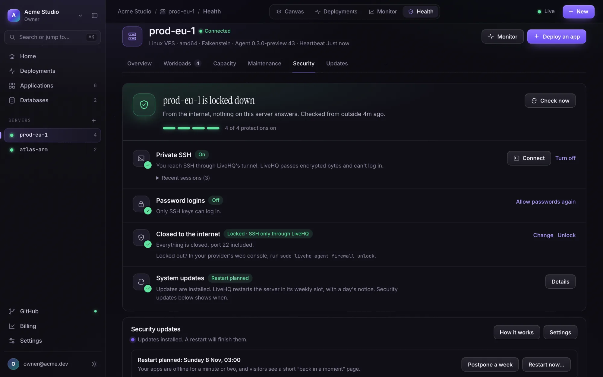

# LiveHQ documentation: instructions for writers and agents

This repository is the user documentation of LiveHQ, published with Mintlify. Pages are
MDX files; `docs.json` holds the navigation and the site settings.

## What LiveHQ is

A person rents their own Linux server, runs one install command, and from then on manages
apps and databases in the web console at `https://console.livehq.dev`. An agent on the
server builds and runs everything in Docker. Visitors reach apps through LiveHQ's edge and
an encrypted tunnel that the server opens outward, so the server needs no open web ports.

There is no public API and no supported command-line tool. Everything a user does happens
in the console, except the install command and the few `livehq-agent` commands these docs
name.

## Who reads these pages

1. People who have never rented a server.
2. Developers who come from Vercel, Render or Coolify.
3. AI agents that read the docs to help a user.

Write every page so the first group can follow it and the third can act on it.

## The rules that matter most

- **Only what is true today.** Document what the console offers. If a feature is off,
  unfinished or limited, say the limit plainly or leave the feature out. Never promise
  zero downtime, high availability, an uptime figure or an SLA.
- **The console's own words.** Buttons, tabs and status words are written exactly as the
  console shows them, in bold: **Deploy application**, **Settings & access**. Never invent
  a label. If you are unsure of one, describe the place without naming the button.
- **One job per page.** The title is the job ("Connect a server", not "Servers"). A page
  that explains an idea says so in its title ("How LiveHQ works").
- **Plain words.** Second person, present tense, short sentences. Explain a server term the
  first time a page uses it, or link to the [glossary](/help/glossary). No "simply", "just",
  "easy", "seamless", "powerful".
- **Say what to do when it goes wrong.** Every task page ends with what the reader may see
  when it fails and the next thing to try.
- **Works as plain text.** Many readers are AI tools that get the Markdown of a page.
  Nothing important may live only in an image. Use tables for reference facts.

## Page shape

```mdx
---
title: "Connect a server"
description: "One sentence, under 160 characters, that says what the reader will have done."
---

One or two sentences: what this is and when you need it.

## Before you start        (only when something is needed first)

## Steps                   (a task: use <Steps>, one action per step)

## What happens next       (what the console shows, how long it takes)

## If something goes wrong (what you see, what it means, what to do)

## Limits                  (only real limits, with their numbers)

## Related                 (two to four links)
```

Not every page needs every heading. Keep pages short: a reader on a phone should reach the
first step without scrolling far.

## Wording

| Write | Not |
| --- | --- |
| server | VPS, box, node, machine (say "a server you rent" the first time) |
| the console | dashboard, panel, UI |
| the sidebar | left rail, rail, menu (the console's own tooltip says "sidebar") |
| app | application, project, service (a **background service** is its own thing) |
| deployment | deploy (as a noun), build (a build is one step of a deployment) |
| workspace | organization, team, account |
| address | URL (except for a database's **connection URL**), hostname |
| custom domain | your own domain name, such as `www.example.com` |
| LiveHQ's edge | proxy, CDN, load balancer |
| the agent | daemon, runner (the LiveHQ program on the server) |
| variables | env vars, secrets |

- Roles are **Owner**, **Admin**, **Developer** and **Viewer**. Say who may do a thing when
  the console restricts it.
- Plans are **Free**, **Pro** ($15 a month) and **Teams** ($49 a month). Say "Pro and
  Teams" when a feature needs a paid plan and link to [Plans](/account/plans).
- Sizes are written as the console writes them (`512 MiB`, `2 GiB`); bandwidth and backup
  storage are decimal (`10 GB`, `2 TB`).
- Example names: workspace `Acme Studio`, server `prod-eu-1`, app `storefront`, database
  `shop-db`, address `storefront.livehq.app`, custom domain `www.example.com`, repository
  `acme/storefront`. Example IP addresses come from `203.0.113.0/24`.
- When a feature depends on the server's agent version, do not name a version. Write: "If
  the console says **Update this server's agent**, see [Update the agent](/servers/update-agent)."

## What never goes in a page

- Internal details: source file names, API paths, database migrations, the names of
  LiveHQ's own hosting providers, the agent's preview numbers.
- A real token, password, enrollment code, connection URL, email address or customer name.
- Comparisons that judge another product. `start/coming-from-other-platforms` maps ideas;
  it does not rank.
- Screenshots of anything but the LiveHQ console with made-up data.

## Components

Use Mintlify's built-in components only.

- `<Steps>` / `<Step title="...">` for procedures.
- `<Note>` for a fact worth stopping for, `<Warning>` for something that can lose data or
  lock the reader out, `<Tip>` for a shortcut. One or two per page at most.
- `<Tabs>` for a real fork (Mac / Windows / Linux), never to hide the main path.
- `<AccordionGroup>` for "what if" questions under a task.
- `<CardGroup>` is not used; group `<Card>` with `<Columns cols={2}>`.
- Tables for statuses, limits and "what you see / what it means / what to do".

In prose, write `<` as `&lt;`, wrap anything with braces in backticks, and write a dollar
sign as `\$`: MDX reads `<` and `{` as code, and two `$` on a line as a formula.

## Screenshots

- Files live in `/images/console/` as `.webp`, 2000 px wide (phones: 780 px).
- Embed with a frame and real alt text:

  ```mdx
  <Frame caption="The Security tab of a server.">
    
  </Frame>
  ```
- The text around a screenshot must be complete without it.
- Every screenshot uses the example workspace `Acme Studio`. Never capture a real
  workspace.

## Links

- Internal links are root-relative with no extension: `[Deploy an app](/apps/deploy)`.
- Every page is listed in `docs.json`; a page that is not listed is not published in the
  navigation, the search or `llms.txt`.
- When a page moves, add a redirect in `docs.json`.

## For AI agents reading the published site

- `/llms.txt` lists every page; add `.md` to any page address for its Markdown.
- `/agents/reference`, `/agents/order-of-operations`, `/agents/status-words` and
  `/agents/limits` are the compact reference. Keep them in step with the task pages: when a
  limit or a status word changes on one page, change it there too.
- `skill.md` at the root is written by hand. It must only describe what a person can do in
  the console.

## Checking a change

Run the link and image check before you commit:

```bash
python3 scripts/check.py
```

It verifies that `docs.json` is valid JSON, that every page in the navigation exists, that
every internal link and image resolves, that every page has a title and a description, and
that no placeholder text is left.
