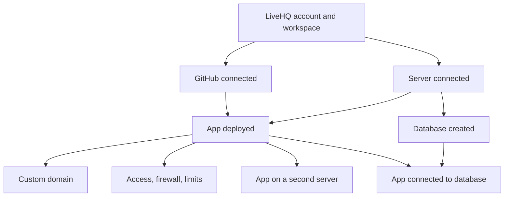

Each job below lists what must be true first, the steps in order with the console's labels, and how to tell that it worked. Follow the links for the detail and the failure cases.

## What must exist before what

| To do this | You first need |
| --- | --- |
| Connect a server | An account; the Owner or Admin role; a free place for a server on the plan; a server with a supported system and `root` or `sudo`. |
| Connect GitHub | The Owner or Admin role. |
| Deploy an app | A connected server; GitHub connected with the repository shared; the Developer role or higher; a free place for an app on the plan. |
| Create a database | A connected server; the Developer role or higher; a free place for a database on the plan. |
| Connect an app to a database | Both exist. On different servers, each server's agent must support the private network. |
| Add a custom domain | A deployed web app; Pro or Teams; a domain whose DNS the person controls; a name that is not bare (`www.example.com`, not `example.com`). |
| Back up a database | Pro or Teams. |
| Run an app on a second server | A deployed app; a second connected server (so Pro or Teams). |
| Invite people | Teams; the Owner or Admin role. |
| Lock a server | The Owner or Admin role. To close port 22 as well: private SSH turned on first, so there is a way back in. |

## From nothing to a live app

1. **Account.** Sign up at `https://console.livehq.dev/signup`. A workspace is created with the account.
2. **Server.** Rent a server with Ubuntu 24.04 (2 vCPU and 4 GB is a comfortable start). See [Rent a server](/start/rent-a-server).
3. **Open it.** `ssh root@SERVER_IP` from a terminal. See [Open your server](/start/open-your-server).
4. **Install.** In the console, **Connect a server**: type a **Server name**, copy the command, press **Create enrollment code**. Paste the command in the SSH session, then the code when asked. The code works once, for 30 minutes. See [Connect a server](/servers/connect).
5. **Confirm.** The console page changes from **Waiting for your server** to "… is ready."
6. **GitHub.** **GitHub** in the sidebar, then **Connect GitHub**. On GitHub: **Only select repositories**, pick the repository, **Install**. See [Connect GitHub](/apps/github).
7. **Deploy.** **New** → **GitHub repository** → pick the repository. Check the app port and the access choice. Press **Deploy application**. See [Deploy an app](/apps/deploy).
8. **Confirm.** The deployment reads **Live** and the app's pill reads **Live**. Its address is `name.livehq.app`.

A beginner should use the console's own guide instead of steps 2 to 7: **Guide me, step by step** on Home.

## Before the first deployment: make the repository ready

Check these in the repository. They are the usual reasons a first deployment fails.

| Check | Why |
| --- | --- |
| The app listens on `0.0.0.0` at the port in the `PORT` variable, not only on `localhost`. | LiveHQ sends traffic to `PORT`. Its value is the **App port** if one is set, else the single port the Dockerfile declares with `EXPOSE`, else `8080` for an automatic build. A Dockerfile with no `EXPOSE`, or with several, needs the **App port** set. |
| `GET /` answers with a status from 200 to 399 within 3 seconds, or another path does. | It is the health check. Set **Health check path** if `/` needs sign-in or is slow. The release has 120 seconds to pass unless **Startup allowance** is changed. |
| Every value the build needs is a variable with the **Build** or **Build & runtime** scope. | Committed `.env` files are left out of the build. A Dockerfile reads build variables as BuildKit secrets. |
| No source folder the app needs is named `build`, `dist`, `target` or another name LiveHQ leaves out. | Those names are skipped wherever they are. See the list on [How LiveHQ builds an app](/apps/builds#what-is-left-out-of-the-build). |
| No Git submodules and no Git LFS files. | They are not fetched, and a `.gitmodules` file at the top of the project directory fails the deployment. |
| The repository is under the source size limits (64 MiB compressed). | See [Limits](/agents/limits). |
| For a monorepo: you know the **Project directory**. | It is set under **Build and health settings** on the Deploy page. |
| Nothing the app must keep is written to its own disk. | An app's files do not survive a deployment. |

See [How LiveHQ builds an app](/apps/builds).

## Deploy a new version

- With deploy on push switched on: push to the app's branch.
- Otherwise: open the app, press **Redeploy**, then **Deploy new release** on the form that opens.
- A changed variable or limit: press **Review and redeploy** on the **Variables** or **Resources** tab, then **Apply and redeploy**. It usually reuses the existing build.
- A changed port or health check path: press **Redeploy**, change it under **Build and health settings**, then **Deploy new release**.

Confirm: the newest entry in the app's **Deployments** tab is tagged **Live**. If it failed, the previous release is still serving. See [What a redeploy does](/apps/redeploy).

## Roll back

Open the app's **Deployments** tab, **Roll back**, confirm "Roll back to the previous release?". It goes back exactly one release, with that release's variables. It does not undo database changes. See [Roll back](/apps/rollback).

## Add a database and connect an app

1. **New** → **PostgreSQL database** or **Redis database**. Choose the server. Press **Create database** (for Redis, **Create Redis database**).
2. Wait until the database reads **Ready**.
3. Open the database's **Connections** tab, **Connect an app**, pick the app and the variable name (`DATABASE_URL` or `REDIS_URL`).
4. LiveHQ creates a database user for the app, seals its private URL into the app's variables and deploys the app.

Confirm: the app's **Variables** tab lists the variable, and the app's newest deployment is **Live**. See [Connect an app](/databases/connect-an-app).

<Warning>
In PostgreSQL, the user that **Connect an app** creates can read and change rows. It cannot create or alter tables. An app that runs migrations when it starts fails with that user: its migrations need the URL of the database's default user, `livehq`. See [If your app runs migrations](/databases/connect-an-app#if-your-app-runs-migrations).
</Warning>

## Add a custom domain

1. Open the app's **Domains** tab. Under **Add a domain**, type a name such as `www.example.com` and press **Add domain**.
2. At the person's domain company, create the DNS record the card shows (a CNAME).
3. Back on the card, press **Check status**. Pending domains also go live by themselves.

Confirm: the domain card reads **Connected** and the domain appears in the app's header. For a bare domain the console says so and offers **Add the www domain**. It does not refuse the bare name (**Add anyway**), but LiveHQ cannot serve it. See [Custom domains](/apps/custom-domains).

## Let other people open an app

Open the app, **Settings & access**, **Who can open this app?**. A new app is private. Choose **Anyone with the link** to make it public, or **Enable password protection** to let in the people you give the password to. The console has no way to invite one person to one app. See [App access](/apps/access) and [Share a private app](/apps/sharing).

## Close a server to the internet

1. Open the server's **Health** → **Security** tab.
2. Turn on **Private SSH** and connect once with the command the console creates.
3. Turn password logins off (keys only).
4. Choose a lock and start its 5-minute test. Prove you can still get in, then **Keep it locked**. Without that, the lock undoes itself.

If locked out: in the hosting company's own web console for the server, run `sudo /opt/livehq-agent/current/livehq-agent firewall unlock`. The program is not a command the terminal finds by name, so the full path is needed. See [Close the server to the internet](/servers/lock-down).

## Diagnose a failed deployment

1. Ask for the banner on the app's **Overview** and the failure line of the newest deployment.
2. Ask for **Copy logs** from that deployment.
3. Classify: failed while building → [A build failed](/help/build-failed). Built, then did not start or failed the health check → [An app won't start](/help/app-wont-start). Mentions memory → [Out of memory](/help/out-of-memory). Waiting, not failed → [Follow a deployment](/apps/deployments).
4. Prefer the console's own fix link when it offers one, such as **Redeploy on port 3100**.

## Diagnose an app that does not open

Check in this order, and stop at the first that explains it:

1. The server's status. **Offline** → [A server is offline](/help/server-offline).
2. The app's status and banner → [App status](/apps/status).
3. Access: a **Private** app shows visitors a sign-in page.
4. Bandwidth: a paused workspace shows "This app is paused for now".
5. The firewall's recent events.
6. For a custom domain: the domain card's status.

See [An app is Unavailable](/help/app-unavailable).

## Leave LiveHQ, or take a copy

**Export everything** on the server's **Health** → **Settings** tab downloads settings and data, encrypted to the person's browser. Removing a server from LiveHQ deletes nothing on the machine, but the console removes a server only after its apps and databases are deleted, so export first. See [Take your data with you](/help/export) and [Remove a server](/servers/remove).

## Related

- [Reference](/agents/reference)
- [Status words](/agents/status-words)
- [Limits](/agents/limits)
