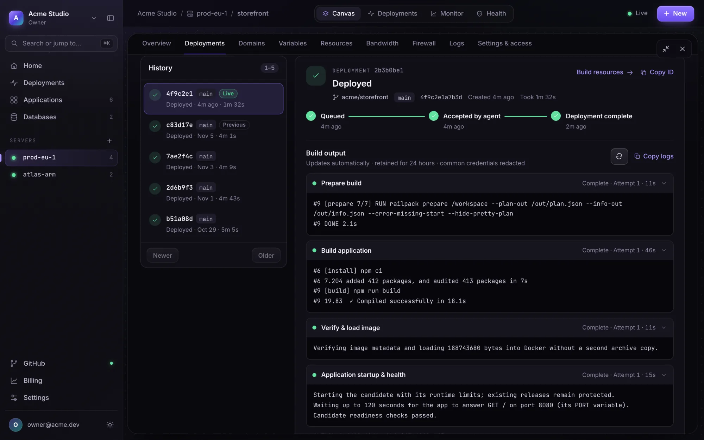

A deployment is one attempt to put a version of an app online. The console shows every step while it runs and keeps the result in the app's history.

## Where to look

| Place | What it shows |
| --- | --- |
| The app's page, **Deployments** tab | Every deployment of that app, with its build output. |
| **Deployments** in the sidebar | The latest attempt for each app, with the filters **All**, **In progress**, **Failed** and **Deployed**. |
| A server's **Deployments** view | The same list for one server. |
| The top of any page | While one runs, a pill reads "storefront deploying". When it ends, a message reads "storefront is live" or "storefront didn't deploy". |

## Read the Deployments tab

<Frame caption="An app's Deployments tab. The capture comes from an older agent: its timings do not describe current deployments.">
  
</Frame>

**History** lists deployments, newest first: the short commit, the branch, a status word, when it started and how long it took. Two tags mark releases: **Live** is the release that serves now, **Previous** is the one a [rollback](/apps/rollback) returns to. **Newer** and **Older** page through the list.

Select a deployment to see its detail: three points (**Queued**, **Accepted by agent**, then the current step) and the build output.

## The steps of a deployment

| The console shows | What is happening |
| --- | --- |
| **Queued** | The deployment waits for the server to take it. |
| **Preparing build** | The server downloads the commit and works out how to build it. |
| **Building application** | Your install and build commands run. |
| **Exporting image**, **Verifying & loading image** | The built image is handed to Docker on the server. |
| **Starting application** | The new release starts beside the one that is serving. |
| **Checking application health** | LiveHQ waits for the new release to answer its health check. |
| **Publishing** | The app's address is switched to the new release. |
| **Live** | The new release serves visitors. |
| **Deployment complete** | The minute of watching has passed and the old release is stopped. |

In **History** the status words are **Queued**, **In progress**, **Live**, **Deployed**, **Failed** and **Cancelled**.

## Live, then a minute of watching

A web app's deployment reads **Live** as soon as its release takes over, with the line "LiveHQ watches it for a minute and keeps any previous release ready to roll back." The header shows **Went live in** and a duration: the time from queueing until that moment, waiting and retries included.

After about a minute of healthy answers the old release is stopped and the deployment reads **Deployed**.

If the new release stops answering during that minute, what happens depends on the deployment:

- **Automatic rollback was allowed:** LiveHQ returns to the previous release and the deployment ends as **Failed**. See [Roll back](/apps/rollback).
- **It was not allowed**, which is the default: the new release stays in service and LiveHQ restarts it, as it does any app that stops answering. The previous release stays ready, and the deployment stays open until the new release has answered for a full minute or you roll back. Other deployments on that server wait until then.

## Build output

Under **Build output** each step has a card: **Prepare build**, **Build application**, **Verify & load image** and **Application startup & health**. A card shows its state (**In progress**, **Complete**, **Failed** or **Interrupted**), the attempt number and how long it took.

- The output updates by itself while the deployment runs.
- It is kept for 24 hours. After that the card area reads "The 24-hour retention period has ended. The deployment result remains in your history."
- Each card keeps the latest 32 KiB of its output. Earlier lines are dropped.
- Common credential formats are hidden, and every web address (`http://…` or `https://…`) reads `[url withheld]`. That is not a promise that nothing secret appears: do not print secrets in a build.

For a web app, the last line says where the time went on your server: "Live after … on this server: build …, loading the image …, start, health check and going live …". [Redeploy an app](/apps/redeploy) explains how to read it.

**Copy logs** copies everything as text: the deployment's ID, status and times, the failure reason and every card's output. **Copy ID** copies the ID alone. Both are what [support](/help/support) asks for.

## When a deployment waits

One deployment runs at a time on a server. A waiting deployment says what it waits for:

| The console shows | Why | What to do |
| --- | --- | --- |
| **Queued behind another build** | Another build is running on this server. | Nothing. It starts by itself when the other ends. |
| **Waiting for disk space** | The server has too little free disk. LiveHQ keeps a reserve free (2 GiB or a tenth of the disk, whichever is larger) and the deployment needs room above it. | It starts once there is room. See [Free disk space](/servers/disk-cleanup). |
| **Preparing the server** | Once, on a server with less than 2 GiB of memory, LiveHQ sets up a swap file for builds. It takes a few minutes. | Nothing. |
| **Waiting for the server's clock** | The server's clock is not confirmed to be right. | It starts once the clock is confirmed. If it stays, write to [support](/help/support). |
| **Waiting for capacity** | The server's agent is an old one that waits for memory. | If the console says **Update this server's agent**, see [Update the agent](/servers/update-agent). |

A deployment does not wait for memory. On a full server it fails once with an out-of-memory reason: see [Out of memory](/help/out-of-memory).

A second deployment of the same app replaces the first if it is still queued, and otherwise waits for it to finish: see [Redeploy an app](/apps/redeploy).

## Stop a deployment

An **Owner**, **Admin** or **Developer** can stop a deployment that has not gone live.

1. Open the deployment and press **Stop deployment**.
2. In **Stop this deployment?** press **Stop deployment** again. **Keep deploying** closes the box.

The deployment ends before going live, so the current release keeps serving and nothing is deleted. A build or start in progress stops within about 25 seconds, and the deployment reads **Cancelled**.

Once the page reads "Going live; it can't be stopped.", use a [rollback](/apps/rollback) afterwards instead. If it reads **Update the agent to stop it**, see [Update the agent](/servers/update-agent).

## When a deployment fails

- The previous release keeps serving. A first deployment that fails leaves the app without a release.
- The reason is on the deployment, on the app's **Overview** and on **Home** under **Needs attention**.
- LiveHQ emails the person who started it. The subject is "Deployment failed: storefront" for an app with no release yet and "Redeploy failed: storefront" for one that has a release. A deployment started by a push counts as started by the person who last deployed the app from the console. If the person who started a deployment is no longer a member of the workspace, its owners and admins get the email. See [Emails LiveHQ sends](/help/emails).

To fix it, see [A build failed](/help/build-failed) or [An app builds but won't start](/help/app-wont-start).

## Limits

- One deployment at a time per server.
- Build output is kept for 24 hours. The result stays in the history.
- LiveHQ checks a release from the server it runs on. It runs no check of your app from outside.

## Related

- [Redeploy an app](/apps/redeploy)
- [Roll back](/apps/rollback)
- [App status](/apps/status)
- [How LiveHQ builds an app](/apps/builds)
