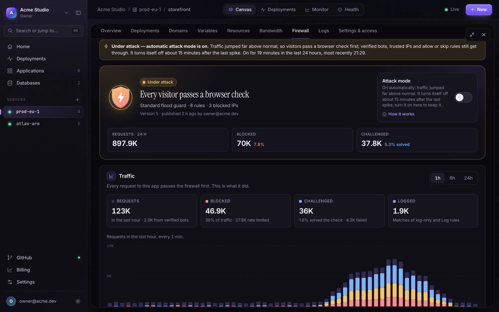

Attack mode puts a quick browser check in front of your whole app. Real people get through in about a second. Scripts and bots that flood your app do not. Use it when a flood of traffic slows or breaks the app and your rules and the flood guard are not enough.

<Frame caption="The Firewall tab while automatic attack mode is on.">
  
</Frame>

## Turn it on

Owners, admins and developers can do this.

<Steps>
  <Step title="Open the switch">
    Open the app, then **Firewall**. The **Attack mode** switch is in the status card at the top. **How it works** beside it opens a short guide.
  </Step>
  <Step title="Confirm">
    Flip the switch. A dialog named **Turn on attack mode?** explains what visitors will see. Press **Turn on and publish**.
  </Step>
</Steps>

It publishes at once and applies within seconds: "Attack mode is on. Live on the edge within seconds." Any unpublished changes you have stay in your draft.

To turn it off, flip the same switch. Attack mode you turned on stays on until you turn it off.

## What visitors see

1. LiveHQ's edge stops each new visitor before anything reaches your server.
2. A page titled "Checking your browser" says "This app asks browsers to pass a quick check before it opens. It takes a few seconds." The browser solves a small puzzle by itself: about a second on a laptop, a few seconds on an older phone. There is nothing to click and no captcha.
3. The visitor gets a pass, kept in a security cookie, and uses your app normally. When the pass ends, the check runs again.

The check needs JavaScript and cookies. A browser without JavaScript is told to turn it on. If the pass cannot be kept (cookies blocked for the site, or a VPN that keeps changing the visitor's address), the page stops after two tries, says why, and offers **Try again**.

### How long a pass lasts

Under **Protections**, **A solved browser check lasts** offers 15 minutes, 1 hour (the default), 4 hours or 24 hours. Longer is smoother for people. Shorter makes each solved check worth less to a bot. A visitor who is past half of the time gets a fresh pass with their next page, so people who keep using the app are not interrupted.

This setting goes through your draft: change it, then **Review and publish**.

## Who gets through, and who does not

| Visitor | During attack mode |
| --- | --- |
| People in a normal browser | Pass the check in about a second |
| Trusted IPs | Skip the check |
| Verified bots, such as Google, Bing and UptimeRobot | Skip the check |
| Requests matched by an **Allow** rule, or a **Skip** rule that names attack mode | Skip the check |
| Scripts and command-line tools, such as curl or Python | Stopped with 403 |
| Mobile apps and servers that call your API | Stopped with 403 |
| Webhooks, crawlers and monitors that LiveHQ does not verify | Stopped with 403 |

<Warning>
Attack mode breaks API clients, mobile apps and webhooks unless you exempt them. Before you need it, add a **Skip** rule that skips **Bot check** and **Attack mode** for the paths they use, such as `/api/webhooks/*`, or trust their IP addresses. The **Let webhooks in** template does this for Stripe and GitHub. See [Write firewall rules](/apps/firewall/rules).
</Warning>

Attack mode does not stop an attacker who drives real browsers. Blocked IPs and rate limits help there.

## Automatic attack mode

LiveHQ can turn attack mode on for you. It is off by default.

<Steps>
  <Step title="Switch it on">
    In the **Firewall** tab, go to **Protections**, then **Attack mode and the browser check**. Turn on **Automatic attack mode**.
  </Step>
  <Step title="Publish">
    Press **Review and publish**, then **Publish**.
  </Step>
</Steps>

How it behaves:

- **When it turns on.** The app receives at least 100 requests a second for 10 seconds, that is at least 8 times its usual rate over the 10 minutes before, and the requests come from at least 5 different visitors. Requests from trusted or blocked IPs, from visitors a rule is still keeping out, and from visitors over the flood guard do not count. Each instance of LiveHQ's edge counts the traffic it receives.
- **How long it stays on.** 15 minutes. Each new jump starts the 15 minutes again.
- **What you see.** A banner "Under attack — automatic attack mode is on.", the status **Under attack**, and an email if **Email alerts** is on. Your own **Attack mode** switch stays off. Flip it if you want attack mode to stay on after the 15 minutes.
- **What it cannot do.** It reacts within about 10 seconds, so the first seconds of a flood still reach your server. It cannot tell a rush of real visitors, like a launch, from an attack: people pass the one-second check, while API clients and webhooks without a skip rule are stopped until it ends.

## When it turns off

| How it was turned on | When it ends |
| --- | --- |
| By you, with the switch | When you flip the switch off. Never by itself. |
| Automatically | About 15 minutes after the last spike |

Turning **Automatic attack mode** off and publishing stops it at the edge at once.

## If something goes wrong

| What you see | What it means | What to do |
| --- | --- | --- |
| Your mobile app, API clients or webhooks fail with 403 while attack mode is on | Machine clients cannot solve the check. | Add a **Skip** rule for their paths that skips **Bot check** and **Attack mode**, or trust their IPs. |
| A visitor says the page keeps checking | Their browser blocks cookies for your site, or a VPN changes their address between requests. | They allow cookies for the site or pause the VPN, then press **Try again**. |
| **Challenged** is high and few are solved | Most of the challenged traffic is not real browsers, which is what attack mode is for. | Nothing. Look at **Top matched** to block the worst addresses. |
| Attack mode turned on during a launch | Automatic attack mode cannot tell a rush from an attack. | People still get in. Turn **Automatic attack mode** off before a planned launch if your API clients have no skip rule. |
| "Someone else published a newer version." | Another member published while you confirmed. | Press **Reload**, then try again. |

## Related

- [How the app firewall works](/apps/firewall/overview)
- [Write firewall rules](/apps/firewall/rules)
- [Limit request rates](/apps/firewall/rate-limits)
- [Read what the firewall did](/apps/firewall/events-and-history)
