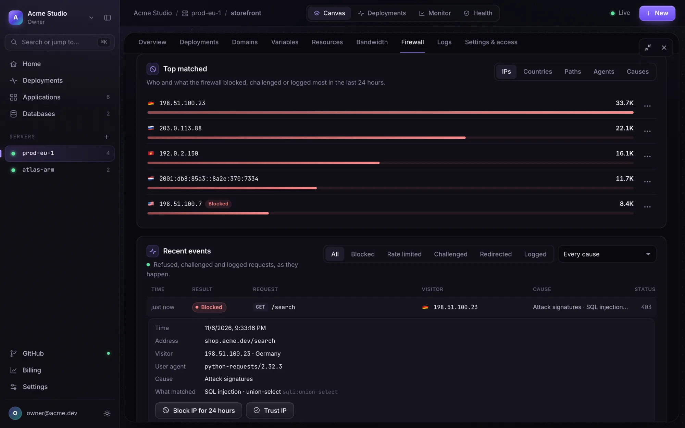

The top half of the app's **Firewall** tab reports what the firewall did. The bottom keeps every published version and lets you export, import and copy a firewall. Every member who can see the app can read all of it; changing things needs the Owner, Admin or Developer role.

## The numbers at the top

The status card shows three numbers for the last 24 hours: **Requests · 24 h**, **Blocked** with its share of traffic, and **Challenged** with the share that solved the check.

## Traffic

**Traffic** covers the range you pick: **1h**, **6h** or **24h**.

| Tile | What it counts |
| --- | --- |
| **Requests** | Every request to the app, with how many came from verified bots |
| **Blocked** | Requests refused, as a share of traffic, with how many of them were rate limited |
| **Challenged** | Requests that got the browser check, with the share that solved it and how many answers failed |
| **Logged** | Matches of rules in **Log only**, of **Log** rules and of protections in **Log only**. These requests went through. |

The chart stacks **Blocked**, **Rate limited**, **Challenged** and **Allowed** over time: one bar per minute for 1h, per 5 minutes for 6h, per 15 minutes for 24h. Press a name in the legend to hide or show that series.

When nothing was refused, the section says "Your firewall is on. Nothing was blocked in the last 24 hours."

## Top matched

**Top matched** lists who and what the firewall blocked, challenged or logged most in the chosen range, up to 10 rows. **Group by** switches between:

| Group | The menu on a row offers |
| --- | --- |
| **IPs** | **Block for 1 hour**, **Block for 24 hours**, **Block always**, **Trust this IP** |
| **Countries** | **Block** and the country's name |
| **Paths** | **Create a rule for this path** |
| **Agents** | **Create a rule for this user agent** |
| **Causes** | **Show the rule** or **Show this protection** |

A cause is the rule or protection that acted: one of your rules by name, or **Blocked IPs**, **Flood guard**, **Attack mode**, **Attack signatures**, **Bot check**, **Fake bots**, **Bad networks**, **Vulnerability scanners**, **AI crawlers**, **Leaked passwords**, **Invalid path** or **In-flight ceiling**.

## Recent events

**Recent events** lists refused, challenged and logged requests as they happen. Requests that were allowed are counted in **Traffic** and are not listed here.

<Frame caption="Top matched, and Recent events with one event opened.">
  
</Frame>

- **Show** filters by result: **All**, **Blocked**, **Rate limited**, **Challenged**, **Redirected**, **Logged**. The list beside it filters by cause, starting at **Every cause**.
- Each row gives **Time**, **Result**, **Request**, **Visitor**, **Cause** and **Status**.
- Press a row to open it: the full address, the visitor's IP and country, the **User agent**, the **Cause**, and **What matched**, for example "SQL injection · union-select".
- An opened event has two quick actions: **Block IP for 24 hours** and **Trust IP**. See [Block and trust IP addresses](/apps/firewall/ip-lists).
- **Older →** and **← Newer** move through pages of 20. The first page refreshes by itself.

A rule in **Log only** shows what it would have done: **Would block**, **Would limit**, **Would challenge** or **Would redirect**. The opened event adds "(log only: the request went through)".

"Penalty from an earlier match" under **What matched** means the visitor is still being kept out or checked by a rule with **Keep blocking that visitor**.

## How long this is kept

Traffic numbers, top lists and events are kept for 24 hours. Nothing about your visitors is kept longer, and the console shows at most the last 24 hours.

- Events are a sample. During a flood, LiveHQ keeps examples of each cause, not every single request. The counts in **Traffic** are complete.
- Events hold the path without its query string.
- There is no export of traffic or events. If you need longer records, log requests in your own app.

## History and Restore

Every publish is kept as a version, the newest 25. **History** lists them with what changed, who published and when. The version in force carries the badge **Live**.

<Steps>
  <Step title="Choose a version">
    In **History**, press **Restore** on the version you want back.
  </Step>
  <Step title="Confirm">
    The dialog **Restore version 4?** explains that its settings are published again as a new version. Press **Restore and publish**.
  </Step>
</Steps>

A restore publishes at once and nothing older is lost. Your unpublished changes stay as a draft on top. A version that uses a shared list deleted since cannot be restored.

## Export, import and copy

The section **Export, import and copy** moves a whole firewall around.

| Button | What it does |
| --- | --- |
| **Export JSON** | Downloads this firewall, with your unpublished changes if you have any, as a JSON file |
| **Import JSON** | Loads a file of at most 1 MB into your draft |
| **Copy from another app** | Loads another app's published rules, protections and IP lists into your draft. Pick the app, then press **Show changes**. |

Imports and copies only change your draft. A dialog lists every change first; press **Replace draft** to accept, then **Review and publish** as usual. Attack mode stays as it is. If the incoming rules use a shared list this workspace does not have, the dialog says so: pick one of your own lists in those rules before publishing.

## Emails

With **Email alerts** on, which is the default, LiveHQ emails the workspace's owners and admins when:

- automatic attack mode turns on for the app, or
- the app refuses or challenges at least 3,000 requests in 5 minutes and that is at least 10 times its usual.

Each kind is sent at most once every 6 hours per app. The email names the top cause, IPs, countries and paths, with a link to the Firewall tab. A workspace receives at most 30 firewall alert emails a day, counted per recipient.

To stop them for an app, turn off **Email alerts** under **Protections**, then publish. See also [Emails LiveHQ sends](/help/emails).

## If something goes wrong

| What you see | What it means | What to do |
| --- | --- | --- |
| "No refused, challenged or logged requests in the last 24 hours." | Nothing matched, or nothing is switched on. | Nothing, if that is what you expect. |
| A visitor says they were blocked and you cannot find the event | Events are a sample and last 24 hours. | Ask for their IP address and the time it happened, look in **Top matched** under **IPs**, and filter **Recent events** by cause. |
| A rule shows "—" under hits | It is an **Allow** or **Skip** rule. Requests they let through are not counted per rule. | Nothing. |
| The cause filter lists "Deleted rule" followed by an id | The rule that acted has been removed since. | Nothing. |
| **Restore** answers that the version cannot be published | It holds something today's checks refuse, or a deleted shared list. | Edit the current firewall by hand. |
| "This file is larger than 1 MB, too large for a firewall." | The import file is not a firewall export. | Export again from the source app. |

## Related

- [How the app firewall works](/apps/firewall/overview)
- [Write firewall rules](/apps/firewall/rules)
- [Block and trust IP addresses](/apps/firewall/ip-lists)
- [Emails LiveHQ sends](/help/emails)
