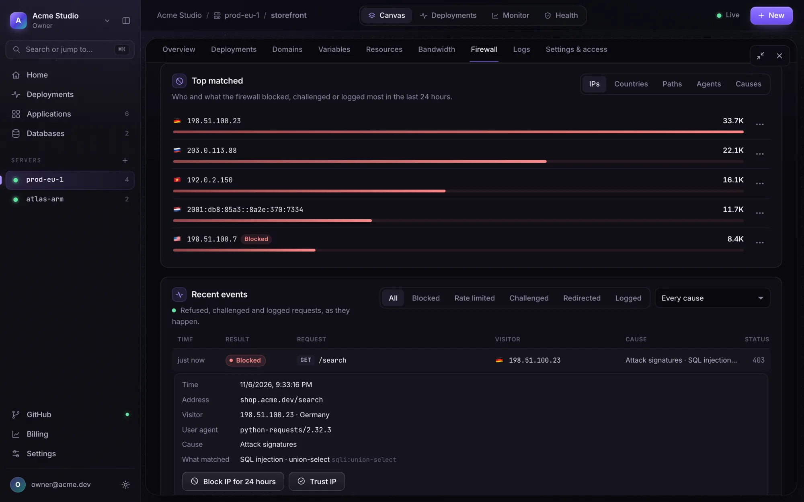
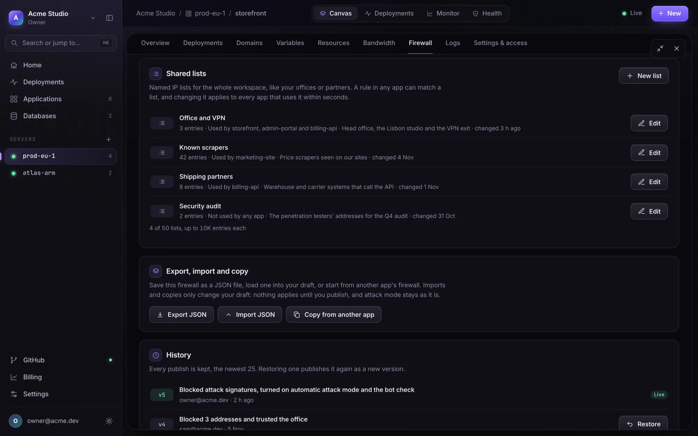

An IP address identifies where a request comes from. The firewall has two lists per app, **Blocked** and **Trusted**, and the workspace can keep named **Shared lists** that rules in any app use.

| List | Effect | Where |
| --- | --- | --- |
| **Blocked** | The visitor gets 403 before any rule runs. | **Firewall** tab, **IP lists** |
| **Trusted** | The visitor skips everything: rules, the flood guard, managed protections and attack mode. | **Firewall** tab, **IP lists** |
| **Shared lists** | Nothing by themselves. A rule decides what happens to addresses on the list. | **Firewall** tab, **Shared lists** |

## Block or trust an address

Owners, admins and developers can do this.

<Steps>
  <Step title="Open the list">
    Open the app, then **Firewall**. In **IP lists**, choose **Blocked** or **Trusted**.
  </Step>
  <Step title="Enter the address">
    Under **IP address or range**, type one address, such as `198.51.100.7`, or a range in CIDR form, such as `203.0.113.0/24`. You can paste several, one per line. Text after an address becomes its note.
  </Step>
  <Step title="Add a note and a duration">
    Fill in **Note** so you know later why the entry exists. For a block, choose **For**: 1 hour, 24 hours, 7 days or Always. The time starts when you publish.
  </Step>
  <Step title="Add and publish">
    Press **Block** or **Trust**. The entry goes to your draft. Press **Review and publish**, then **Publish**.
  </Step>
</Steps>

To remove an entry, press the bin on its row and publish. A block with an end time stops applying by itself when the time is up.

<Warning>
Trust only addresses you control, such as your office or your own servers. A trusted address skips every protection, attack mode included. To let a service past only some checks, write a **Skip** rule. See [Write firewall rules](/apps/firewall/rules).
</Warning>

### IPv6 addresses

A home or a server usually has a whole IPv6 network (a /64) and can switch to any address in it. When you type a single IPv6 address, the console suggests the /64 and offers **Use the /64 network**. Blocking one address of the network rarely holds.

## Act straight from traffic

You do not need to copy addresses by hand. These quick actions publish at once, after a confirmation, and leave your draft alone.

| Where | Action | Effect |
| --- | --- | --- |
| **Recent events**, inside an opened event | **Block IP for 24 hours** | Blocks that visitor for 24 hours, with the note "Blocked from traffic" |
| **Recent events**, inside an opened event | **Trust IP** | Adds the address to **Trusted**, with the note "Trusted from traffic" |
| **Top matched**, grouped by **IPs**, the menu on a row | **Block for 1 hour**, **Block for 24 hours**, **Block always**, **Trust this IP** | The same, with your choice of time |
| **Top matched**, grouped by **Countries**, the menu on a row | **Block** and the country's name | Adds the country to your "Block countries" rule, or creates that rule |

The confirmation button reads **Block and publish** or **Trust and publish**. For an IPv6 visitor the dialog lets you choose between the network and the one address. A quick block never shortens a longer block that is already in place.

<Frame caption="Top matched and an opened event with its two quick actions.">
  
</Frame>

## Shared lists for the whole workspace

A shared list is a named set of addresses, such as "Offices" or "Partners". A rule in any app of the workspace can match it, and when you change the list, every app that uses it follows within seconds.

Owners and admins create and change shared lists. Other members can view them.

<Steps>
  <Step title="Create the list">
    In the **Firewall** tab of any app, go to **Shared lists** and press **New list**. Give it a **Name**, an optional description, and its addresses, each with a note if you like. Press **Create list**.
  </Step>
  <Step title="Use it in a rule">
    Add or edit a rule. Add a **Visitor IP** condition and choose **is in workspace list** or **is not in workspace list**, then pick the list. The **Lock a path to a list** template builds such a rule for `/admin`.
  </Step>
  <Step title="Publish the rule">
    Press **Review and publish**, then **Publish**.
  </Step>
</Steps>

Shared lists are saved as soon as you press **Create list** or **Save list**. They are not part of the draft, and a change to a list applies to every app that uses it without a publish.

A list that a published rule uses cannot be deleted. The console names the apps: remove the list from those rules and publish. Then open the list with **Edit**, press **Delete**, and confirm with **Delete list**.

<Frame caption="Shared lists, with the apps that use each one.">
  
</Frame>

## Lists LiveHQ keeps for you

You do not need to collect the addresses of well-known networks. In a rule, the **Network list** condition matches lists LiveHQ refreshes from each owner's official source: Tor, Cloud providers (AWS, Google Cloud, Oracle Cloud and DigitalOcean), Bad networks, Stripe webhooks, GitHub webhooks and UptimeRobot. Microsoft Azure, Hetzner and OVH publish no list and are not covered.

## Limits

| | Free | Pro and Teams |
| --- | --- | --- |
| Blocked and trusted entries per app, together | 100 | 2,000 |
| Shared lists per workspace | 3 | 50 |
| Entries in one shared list | 1,000 | 10,000 |

- A note holds up to 80 characters.
- A trusted range can be no wider than an IPv4 /8 or an IPv6 /16. A blocked range has no such limit.
- The shared lists that one app's rules use can hold 50,000 entries together.

## If something goes wrong

| What you see | What it means | What to do |
| --- | --- | --- |
| A message ending "isn't an IP address or range. Use addresses like 198.51.100.7 or ranges like 203.0.113.0/24.", or "Write ranges in CIDR form, like 203.0.113.0/24." | The text is not an address or a CIDR range. A range written as "a - b" or with a netmask is not accepted. | Write the range in CIDR form. |
| A notice that the address "is already blocked" and "Nothing changed.", or "That is already in place. Nothing was published." | The address is already blocked for at least as long, or already trusted. | Nothing. |
| A blocked visitor comes back | They changed address. Many networks give out new addresses often. | Block the range, use a rate limit, or turn on [attack mode](/apps/firewall/attack-mode) during an attack. |
| You blocked yourself | Your own address is on **Blocked**, or in a blocked country or range. | Open the console and remove the entry, then publish. Your app's firewall never applies to the console itself. |
| A list cannot be deleted | A published rule in some app uses it. | Remove it from those rules, publish, then delete. |
| **New list** is missing | You are a developer or a viewer. | Ask an owner or an admin. |

## Related

- [Write firewall rules](/apps/firewall/rules)
- [Read what the firewall did](/apps/firewall/events-and-history)
- [How the app firewall works](/apps/firewall/overview)
