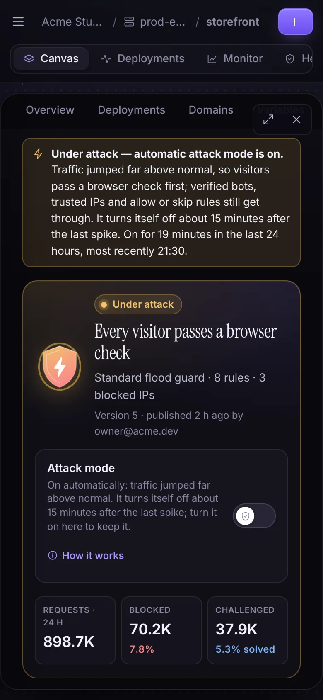

Every app has its own firewall. It runs at LiveHQ's edge, so a request it refuses never reaches your server. You set it in the app's **Firewall** tab. A [background service](/apps/background-services) has no firewall, because nothing on the internet can reach it.

Three things to know first:

- **It costs nothing.** Every feature is on every plan. Plans differ only in how many rules and list entries you may keep.
- **Refused traffic is free.** Requests the firewall blocks, limits, challenges or redirects do not count toward your [bandwidth](/apps/bandwidth).
- **Nothing is on until you choose it.** A new app has no rules, no flood guard and no managed protection. The tab then shows the status **Defaults**. Apart from a very high ceiling on simultaneous requests per app, LiveHQ sets no limit on your visitors by itself.

<Frame caption="The top of the Firewall tab on a phone, while automatic attack mode is on.">
  
</Frame>

## The order of the checks

For every request to the app, the edge goes down this list and stops at the first step that refuses or allows the request.

| Step | Check | Result when it applies |
| --- | --- | --- |
| 1 | A path with `.` or `..` parts, which servers read in different ways | Refused with 400, for every visitor |
| 2 | **Trusted IPs** | The visitor skips the rest of the firewall |
| 3 | **Blocked IPs** | Refused with 403 |
| 4 | A visitor that a rule is still keeping out or checking | Gets that rule's answer again |
| 5 | **Flood guard**, if you chose a level | Refused with 429 |
| 6 | Your **Rules**, from top to bottom | Whatever the first deciding rule says |
| 7 | Managed lists: **Bad networks**, **Fake bots**, **Vulnerability scanners**, **AI crawlers** | Refused with 403 |
| 8 | **Attack signatures** | Blocked, checked or only logged, as you set it |
| 9 | **Bot check** | The browser check, or only logged |
| 10 | **Attack mode**, yours or automatic | The browser check |
| 11 | **Leaked passwords** | Never refused: your app gets a header |

A request that passes continues to the bandwidth check, the app's [access setting](/apps/access) and your server. On a private app the firewall runs before the sign-in page, so that page is protected too.

Nothing is refused silently. A refused visitor sees a LiveHQ page that names the firewall, the response carries the header `X-LiveHQ-Mitigated`, and the request is counted in the tab.

## The parts of the Firewall tab

| Part | What it is for | Read more |
| --- | --- | --- |
| The status card | The firewall's status, the **Attack mode** switch and three numbers for the last 24 hours | [Attack mode](/apps/firewall/attack-mode) |
| **Traffic** | Requests, blocked, challenged and logged over 1, 6 or 24 hours | [Events and history](/apps/firewall/events-and-history) |
| **Top matched** | The IPs, countries, paths, agents and causes matched most | [Events and history](/apps/firewall/events-and-history) |
| **Recent events** | Refused, challenged and logged requests as they happen | [Events and history](/apps/firewall/events-and-history) |
| **Rules** | Your ordered rules, and **Start from a template** | [Rules](/apps/firewall/rules) and [Rate limits](/apps/firewall/rate-limits) |
| **Protections** | **Flood guard**, attack mode's settings, and **Managed protections** | [Managed protections](/apps/firewall/protections) |
| **IP lists** | Blocked and trusted addresses of this app | [IP lists](/apps/firewall/ip-lists) |
| **Shared lists** | Named IP lists for every app in the workspace | [IP lists](/apps/firewall/ip-lists) |
| **Export, import and copy** | Save the firewall as a file, load one, or copy another app's | [Events and history](/apps/firewall/events-and-history) |
| **History** | Every published version, with **Restore** | [Events and history](/apps/firewall/events-and-history) |

## Status words

| Status | Meaning |
| --- | --- |
| **Defaults** | Nothing that refuses or checks requests is on: no flood guard level, no enforcing rule, no protection set to block or check, no automatic attack mode, no blocked IP. Rules and protections in **Log only** do not change this status. |
| **Protected** | At least one of those applies. |
| **Attack mode on** | You turned attack mode on. Every visitor passes a browser check. |
| **Under attack** | Automatic attack mode turned itself on after a jump in traffic. |

## Draft and Publish

Changes to rules, protections and IP lists do not apply as you make them. They collect in a draft.

<Steps>
  <Step title="Edit">
    Add, change or remove rules, protections and list entries. A bar at the bottom counts them: "3 unpublished changes".
  </Step>
  <Step title="Review">
    Press **Review and publish**. A dialog lists each change in plain words and names anything that must be fixed first.
  </Step>
  <Step title="Publish">
    Press **Publish**. The console answers "Published version 6. Live on the edge within seconds."
  </Step>
</Steps>

- **Discard** throws the draft away and leaves the firewall as it is.
- The draft is kept in your browser tab, for you and this app only. It survives a reload. It is gone when you close the tab, and nobody else sees it.
- If someone else publishes while you edit, you see "Someone else published a newer version." Press **Reload**: your unpublished changes are kept on top of their version, so you can review them again before publishing.

Some actions skip the draft and publish at once: the **Attack mode** switch (turning it on asks you to confirm; turning it off does not), and, after a confirmation, the quick actions on traffic (**Block IP for 24 hours**, **Trust IP**, blocking a country) and **Restore**. Shared lists are saved on their own, outside the draft.

## Who may change the firewall

| Role | Firewall tab | Shared lists |
| --- | --- | --- |
| Owner, Admin | Change and publish | Create, change and delete |
| Developer | Change and publish | View |
| Viewer | Read only | View |

A viewer sees everything the firewall did, with the note **Read only**.

## Sizes per plan

| | Free | Pro and Teams |
| --- | --- | --- |
| Rules per app | 10 | 100 |
| Blocked and trusted IP entries per app, together | 100 | 2,000 |
| Conditions in a rule, or in one group | 8 | 8 |
| Groups in a rule | 5 | 5 |
| Values in one "is any of" condition | 100 | 500 |
| Shared lists per workspace | 3 | 50 |
| Entries in one shared list | 1,000 | 10,000 |
| Published versions kept | 25 | 25 |

After a move to Free, a list that is above Free's size can stay or shrink. It cannot grow.

## What it does not do

- It keeps traffic numbers and events for 24 hours, not longer, and cannot export them.
- Rules match text and patterns with `*`. There are no regular expressions.
- Rules belong to one app. Only IP lists can be shared across a workspace.
- Attack signatures are patterns for common attacks. They do not replace fixing your app.
- The browser check stops scripts and simple bots. It does not stop a person, or an attacker who drives real browsers.
- Alerts are sent by email only.

## Related

- [Use attack mode](/apps/firewall/attack-mode)
- [Write firewall rules](/apps/firewall/rules)
- [Turn on managed protections](/apps/firewall/protections)
- [Read what the firewall did](/apps/firewall/events-and-history)
