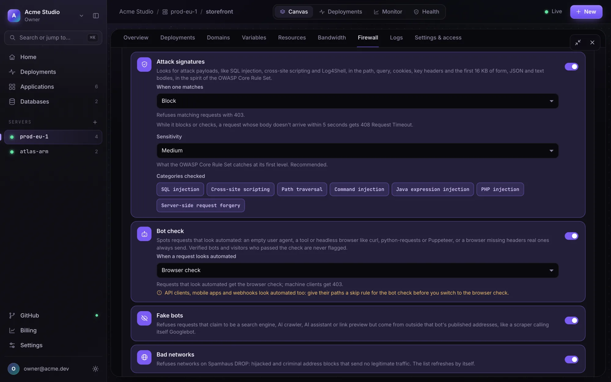

Managed protections are lists and checks that LiveHQ keeps up to date, so you have nothing to maintain. You switch them on per app. All of them are off for a new app.

Find them in the app's **Firewall** tab, under **Protections**, then **Managed protections**. Owners, admins and developers can change them. Like rules, a change goes to your draft and applies after **Review and publish**.

<Frame caption="Managed protections, with attack signatures set to Block.">
  
</Frame>

## The protections

| Protection | What it refuses | When you turn it on |
| --- | --- | --- |
| **Attack signatures** | Requests that carry attack payloads, such as SQL injection, cross-site scripting or Log4Shell | Starts in **Log only**. You then choose **Browser check** or **Block**. |
| **Bot check** | Requests that look automated get the browser check | Starts in **Log only**. You then choose **Browser check**. |
| **Fake bots** | Requests that claim to be a search engine, AI crawler, AI assistant or link preview but come from outside that bot's published addresses | Refuses with 403 at once |
| **Bad networks** | Networks on Spamhaus DROP: hijacked and criminal address blocks | Refuses with 403 at once |
| **Vulnerability scanners** | Well-known probes for weak spots, such as `/.env`, `/.git/` and `/wp-login.php`, and scanner tools | Refuses with 403 at once |
| **AI crawlers** | AI training crawlers such as GPTBot, ClaudeBot and CCBot | Refuses with 403 at once |
| **Leaked passwords** | Nothing. It tells your app when a sign-in uses a password known from breaches. | Adds a header for your app |

<Warning>
Leave **Vulnerability scanners** off for WordPress and other PHP apps. It refuses paths those apps really use.
</Warning>

## Attack signatures

Attack signatures look for attack payloads in the path, the query string, cookies, key headers and the first 16 KB of the request body.

<Steps>
  <Step title="Switch it on">
    Turn on **Attack signatures** and publish. It starts in **Log only**: nothing is refused.
  </Step>
  <Step title="Watch for a few days">
    Read **Recent events**. Each event names the category and the signature, such as `sqli:union-select`. Look for your own pages among them.
  </Step>
  <Step title="Exempt what legitimately carries code">
    Pages that really send code or SQL, such as an admin editor, a query console or an upload of HTML, SVG or SQL files, need a **Skip** rule that skips **Attack signatures** for their paths.
  </Step>
  <Step title="Enforce">
    Under **When one matches**, choose **Browser check** or **Block**, and publish.
  </Step>
</Steps>

| Setting | Choices |
| --- | --- |
| **When one matches** | **Log only**: counts what would be refused. **Browser check**: people pass a quick check; scripts sending attacks do not. **Block**: refuses with 403. |
| **Sensitivity** | **Low**: only signatures that almost never match normal traffic. **Medium**: the recommended level. **High**: broader patterns; expect some false positives. |
| **Categories checked** | SQL injection, Cross-site scripting, Path traversal, Command injection, Java expression injection, PHP injection, Server-side request forgery. Untick one to stop checking it. |

Good to know:

- Password fields are never inspected, so a password with quotes or dashes passes a sign-up form.
- While it blocks or checks, a request whose body does not arrive within 5 seconds gets 408 Request Timeout.
- At **High**, any request body longer than 16 KB is flagged, because the rest cannot be inspected. Upload pages and large JSON requests then need a **Skip** rule.
- At **Medium**, query filters written with `$` operators, such as `filters[name][$eq]=x`, are flagged. Exempt those paths or use **Low**.
- Signatures are patterns for common attacks. Some crafted attacks pass. Keep fixing vulnerabilities in your app.

## Bot check

The bot check spots requests that look automated: an empty user agent, a tool or headless browser such as curl, python-requests or Puppeteer, or a browser missing the headers real browsers always send.

- **Log only** counts the requests it would check, with the reason in each event.
- **Browser check** sends those requests the [browser check](/apps/firewall/attack-mode). Machine clients cannot pass it and get 403.
- Verified bots and visitors who already passed the check are never flagged.

API clients, mobile apps and webhooks look automated too. Give their paths a **Skip** rule before you switch to **Browser check**.

## Fake bots, bad networks and AI crawlers

- **Fake bots** compares what a request claims to be with where it comes from. A scraper calling itself Googlebot from an address Google does not publish is refused. It only judges on fresh lists: if LiveHQ could not refresh a bot's addresses in the last 7 days, it refuses nothing for that bot.
- **Bad networks** uses the Spamhaus DROP list, which refreshes by itself.
- **AI crawlers** refuses crawlers that collect pages to train models. Assistants that fetch a page because a person asked, and search crawlers, are not on the list. To refuse those as well, write a rule on **Verified bot** or **User agent**.

## Leaked passwords

When a `POST` has a form or JSON field named like a password, LiveHQ's edge checks it against the Have I Been Pwned list of breached passwords. The password itself is never sent: only the first 5 characters of its SHA-1 hash leave the edge.

A breached password reaches your app with the header `X-LiveHQ-Leaked-Password: 1`. Your app decides what to do, for example ask for a reset or a second factor. LiveHQ refuses nothing, and it removes that header from anything a visitor sends, so your app can trust it. If the lookup is slow or fails, the request goes through unflagged.

## Exempt webhooks and API clients

Protections built for browsers stop machines that are welcome: payment webhooks, your mobile app, a partner's server. Exempt them with a **Skip** rule.

<Steps>
  <Step title="Add a rule">
    In **Rules**, press **Add rule**. Or use the **Let webhooks in** template, which is ready for Stripe and GitHub.
  </Step>
  <Step title="Pick the requests">
    Under **When**, add **Path** starts with the path they call, such as `/api/webhooks/`. Narrow it further where you can: a **Network list** condition for Stripe or GitHub, a **Visitor IP** condition for a partner, or a **Header** that is present.
  </Step>
  <Step title="Choose Skip">
    Under **Then**, press **Skip** and tick **Bot check** and **Attack mode**. Leave **Attack signatures** and **The rules below this one** unticked unless you need them, so rate limits and signatures still apply.
  </Step>
  <Step title="Publish">
    Press **Add to draft**, then **Review and publish** and **Publish**. New skip rules go to the top of the list.
  </Step>
</Steps>

Verified bots need no rule for the bot check or attack mode: search engines, known webhook senders and uptime monitors that LiveHQ can confirm by their published addresses skip the browser check by themselves.

## If something goes wrong

| What you see | What it means | What to do |
| --- | --- | --- |
| A real page is blocked with cause **Attack signatures** | A false positive, often an editor, a search box or an upload. | Open the event, note the signature, add a **Skip** rule for that path or untick the category. |
| Events say `oversize` or `body-oversize` | A value or a body was too long to inspect fully. | Exempt the path with a **Skip** rule, or lower **Sensitivity** from **High**. |
| Your API clients get 403 after you turned on **Bot check** | They look automated. | Add the **Skip** rule above. |
| A WordPress or PHP app returns 403 on its own pages | **Vulnerability scanners** refuses paths it uses. | Turn that protection off. |
| A search engine stopped visiting | A rule or **Fake bots** refused it. | Check **Recent events** for its user agent. The **Let search engines in** template allows verified search engines. |
| Requests fail with 408 | The body arrived too slowly while attack signatures block or check. | Check the client's connection, or exempt the upload path. |

## Related

- [Write firewall rules](/apps/firewall/rules)
- [Use attack mode](/apps/firewall/attack-mode)
- [Read what the firewall did](/apps/firewall/events-and-history)
- [How the app firewall works](/apps/firewall/overview)
