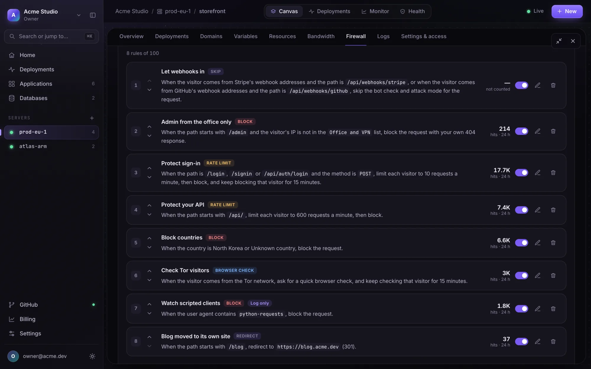
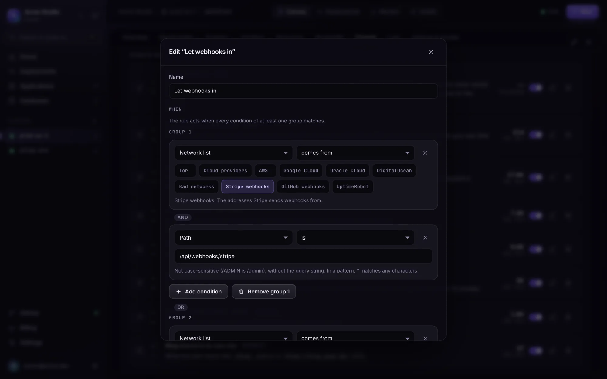

A rule says: when a request looks like this, do that. You write rules in the **Rules** part of the app's **Firewall** tab. Owners, admins and developers can write them.

<Frame caption="Eight example rules. Each row says in plain words what the rule does.">
  
</Frame>

## Add a rule

<Steps>
  <Step title="Open the editor">
    Open the app, then **Firewall**. In **Rules**, press **Add rule**. Or pick a card under **Start from a template** and adjust it.
  </Step>
  <Step title="Name it">
    Type a **Name** that says what the rule is for, such as "Protect sign-in". Up to 80 characters.
  </Step>
  <Step title="Say when it applies">
    Under **When**, choose what to look at, how to compare it, and the value. Press **Add condition** for more. With no condition, the rule applies to every request.
  </Step>
  <Step title="Say what to do">
    Under **Then**, choose one action: **Block**, **Browser check**, **Rate limit**, **Allow**, **Skip**, **Redirect** or **Log**.
  </Step>
  <Step title="Check the sentence">
    **In plain words** shows the rule as a sentence. Read it: it is the best check that the rule says what you mean.
  </Step>
  <Step title="Save and publish">
    Press **Add to draft**. The rule is not active yet. Press **Review and publish**, then **Publish**. It applies within seconds.
  </Step>
</Steps>

<Tip>
Not sure a rule is right? Turn on **Log only** in the editor before saving. The rule then acts on nothing and only counts what it would have done. Read the results in **Recent events**, then switch **Log only** off and publish again.
</Tip>

## Conditions

<Frame caption="The rule editor, with two groups joined by OR.">
  
</Frame>

| What to look at | Comparisons offered | Notes |
| --- | --- | --- |
| **Path** | starts with, is, is not, ends with, contains, doesn't contain, matches pattern, is any of, is none of | Not case-sensitive, without the query string. In a pattern, `*` matches any characters. |
| **Method** | is, is not | `GET`, `HEAD`, `POST`, `PUT`, `PATCH`, `DELETE`, `OPTIONS`. Choosing `GET` covers `HEAD` too. |
| **Country** | is, is not | The visitor's country. "Unknown country" is a choice. |
| **Continent** | is, is not | From the country. Unknown countries and Tor have no continent. |
| **Visitor IP** | is in, is not in, is in workspace list, is not in workspace list | Addresses and ranges such as `203.0.113.0/24`, or a [shared list](/apps/firewall/ip-lists). |
| **Network list** | comes from, doesn't come from | Lists LiveHQ keeps up to date: Tor, Cloud providers, AWS, Google Cloud, Oracle Cloud, DigitalOcean, Bad networks, Stripe webhooks, GitHub webhooks, UptimeRobot. |
| **Verified bot** | is, is not | Any verified bot, Search engines, AI crawlers, AI assistants, Link previews, Webhooks, Uptime monitors. |
| **User agent** | contains, doesn't contain, is, is not, starts with, matches pattern, is any of, is none of | The browser or tool the visitor says it is. Not case-sensitive. |
| **Domain** | is, is not, ends with, is any of, is none of | For apps with several addresses. A name only, without `https://` or a path. |
| **Query string** | contains, doesn't contain, is, is not | The text after `?`. Case-sensitive. |
| **Header** | is, is not, starts with, contains, doesn't contain, matches pattern, is any of, is none of, is present, is missing | You name the header. Not case-sensitive. |
| **Cookie** | is present, is missing, and the same comparisons as Header | You name the cookie. Case-sensitive. |
| **Request body** | contains, doesn't contain | The first 16 KB of the body, not case-sensitive. |

A verified bot is a known crawler or service whose user agent names it and whose IP address is in the list its owner publishes. A scraper that calls itself Googlebot is not one.

### AND and OR

- Conditions listed together are joined by **and**: all of them must match.
- **Add an OR group** adds a second set of conditions, joined to the first by **or**. The rule then acts when every condition of at least one group matches. A rule can have up to 5 groups of up to 8 conditions each.

### How paths are compared

- `/ADMIN` matches a rule on `/admin`, and `//login` matches `/login`.
- With **is**, one trailing slash is ignored: `/login/` matches `/login`.
- You can type spaces and accents as they read: a rule on `/my page` matches what browsers send for it.
- A path value cannot contain `?` or `#`. Use a **Query string** condition for what follows `?`.
- There are no regular expressions. Use **matches pattern** with `*`.

## Actions

| Action | What it does | Options |
| --- | --- | --- |
| **Block** | Refuses the request with 403 and LiveHQ's page "This request was blocked". | **Your own response**: your status, content type and a body of up to 4,096 characters, for example 404 so the path seems not to exist. **Keep blocking that visitor**. |
| **Browser check** | Visitors pass a quick, automatic browser check, then keep a pass for a while. Scripts cannot. | **Keep checking that visitor**. |
| **Rate limit** | Counts requests and acts on the ones past your limit. | See [Limit request rates](/apps/firewall/rate-limits). |
| **Allow** | Lets the request straight through. Later rules, managed protections, the bot check and attack mode are skipped. | None. |
| **Skip** | Lets the request past the protections you tick. Everything else still applies. | **The rules below this one**, **Managed lists**, **Attack signatures**, **Bot check**, **Attack mode**. |
| **Redirect** | Sends the visitor to another path or site. | **Send visitors to**: a path starting with `/`, or an `https://` address. **Kind of redirect**: 302, 307, 303, 301 or 308. |
| **Log** | Counts the request in your events and lets it continue. | None. |

**Keep blocking that visitor** (or **Keep checking that visitor**) makes the rule's answer stick: after one match, every request from that visitor to this app gets the same answer, on every path, for 1 minute, 5 minutes, 15 minutes, 1 hour, 6 hours or 24 hours. It ends early when you delete the rule, turn it off or set it to **Log only**. Trusted IPs are never kept out. The console has no list of the visitors currently kept out.

<Warning>
**Allow** switches off every protection for the requests it matches. For webhooks and API clients, prefer **Skip** with **Bot check** and **Attack mode** ticked: rate limits and attack signatures then still apply.
</Warning>

Browsers remember permanent redirects (301 and 308) for a long time, even after you remove the rule. Start with 302.

## Order

Rules are checked from top to bottom.

- The first rule that blocks, challenges, redirects or allows a request decides. Rules below it are not checked for that request.
- **Skip** and **Log** rules mark the request and the list continues. So does a **Rate limit** rule while the visitor is within the limit, and a **Browser check** rule for a visitor who already has a pass.
- Move a rule with the up and down arrows on its row. The move goes to your draft.
- New **Allow** and **Skip** rules are placed at the top, so no rule above them acts first.

Each row has a switch. A rule that is switched off stays in the list with the badge **Off** and does nothing.

## Templates

**Start from a template** creates an ordinary rule, or turns on a protection, that you can read and edit. Rule templates open in the editor first.

| Template | What you get |
| --- | --- |
| **Protect sign-in** | `POST` requests to common sign-in paths limited to 10 a minute per visitor, then that visitor is blocked for 15 minutes. |
| **Protect your API** | Each visitor limited to 600 requests a minute on paths starting with `/api/`. |
| **Let webhooks in** | Stripe and GitHub webhooks skip the bot check and attack mode, only from their own addresses and only on `/api/webhooks/stripe` and `/api/webhooks/github`. |
| **Block countries** | A block rule for the countries you choose. |
| **Let search engines in** | Verified search engines are allowed past the rest of the firewall. |
| **Block Tor** | Visitors from the Tor network are blocked. |
| **Check cloud traffic on sign-in** | Sign-in attempts from cloud servers pass a browser check first. |
| **Lock a path to a list** | Only addresses on a shared list reach `/admin`. Everyone else gets 404. |
| **Ban scrapers for an hour** | A visitor past 300 page requests a minute is blocked from the whole app for an hour. |
| **Maintenance redirect** | Every visitor is sent to `/maintenance`. It is added switched off. |

Change the paths in a template to the ones your app uses. The other cards (**Block attack payloads**, **Block vulnerability scanners**, **Block AI crawlers**, **Block fake bots**, **Block bad networks**, **Watch for bots**, **Flag leaked passwords**) turn on a [managed protection](/apps/firewall/protections).

## Hits

Each rule shows **hits · 24 h**: how often it matched in the last 24 hours. A rule in **Log only** counts too. **Allow** and **Skip** rules show "not counted": requests they let through are not counted per rule.

## If something goes wrong

| What you see | What it means | What to do |
| --- | --- | --- |
| "Fix the highlighted fields to save this rule." | A value is missing or not allowed. | Read the message under the field marked in red. |
| The rule is in the list and nothing happens | It is still in your draft, switched off, or in **Log only**. | Publish, switch it on, or turn **Log only** off. |
| A rule never matches | A rule above it decides first, or the value does not match what visitors send. | Move the rule up, or set it to **Log only** with a wider condition and read **Recent events**. |
| Your webhooks or API clients are refused | A block, bot check or attack mode stops them. | Add a **Skip** rule for their paths. New skip rules go to the top. |
| A redirect loops | The rule matches the path it redirects to. The editor warns about this. | Exclude the target with **Path** "is not", as the maintenance template does. |
| **Add rule** is switched off | The app has its plan's number of rules: 10 on Free, 100 on Pro and Teams. | Delete a rule, or see [Plans](/account/plans). |

## Related

- [Limit request rates](/apps/firewall/rate-limits)
- [Block and trust IP addresses](/apps/firewall/ip-lists)
- [Turn on managed protections](/apps/firewall/protections)
- [Read what the firewall did](/apps/firewall/events-and-history)
