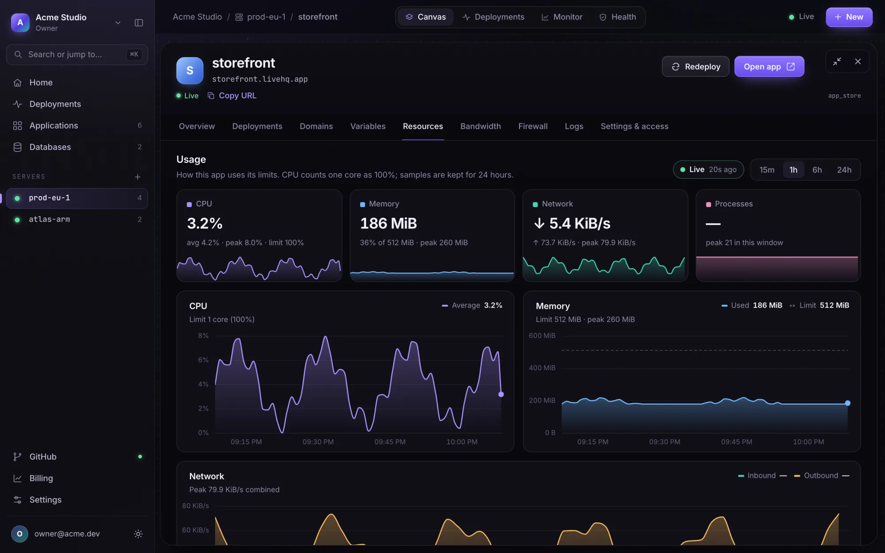

Every app runs with a memory limit and a CPU limit. The **Resources** tab shows how much of each the app uses and lets you change them. An app starts with 512 MiB and 1 core unless you chose other values when you deployed it.

## Read usage

Open the app, then **Resources**. The **Usage** panel shows the last **15m**, **1h**, **6h** or **24h**. It opens on **1h**.

<Frame caption="The Resources tab of an app.">
  
</Frame>

| Tile | What it shows |
| --- | --- |
| **CPU** | Use now, then the average, the peak and the limit. One core counts as 100%, so a limit of 2 cores reads 200%. |
| **Memory** | Use now, its share of the limit, and the peak. |
| **Network** | Data received (↓) and sent (↑) per second, and the peak. |
| **Processes** | How many processes run in the app's container now, and the peak in this window. |

Below the tiles are charts for **CPU**, **Memory** and **Network**.

- **The limit line.** A dashed **Limit** line appears once the peak in the window reaches a third of the limit. Before that the chart zooms in on the use itself, and its heading states the limit.
- **Peaks.** On **6h** and **24h** a dashed **Peak** line shows the highest value in each step of the chart.
- **Marks.** Each deployment and each [restart](/apps/restarts) is marked on the CPU and memory charts.
- **Freshness.** The badge reads **Live** with the age of the newest sample, or **Delayed** when that sample is older than 45 seconds. A new value arrives every 15 seconds. History holds one sample a minute and is kept for 24 hours.

When the numbers call for a change, a line of advice appears under the tiles:

| The console says | Shown when |
| --- | --- |
| "Memory peaked at 93% of its 512 MiB limit in the last hour. Raise the limit to avoid out-of-memory restarts." | The peak reached 90% of the limit. |
| "CPU averaged 85% of its 1 core limit in the last hour, so requests may slow down. Raise the CPU limit." | The average reached 80% of the limit. |
| "Memory stayed under 22% of its limit for 24 hours. A lower limit would free memory for other apps on this server." | On **24h**, the peak stayed under 30% of a limit above 256 MiB. |

The app's **Overview** carries a short version of this panel, **Usage** for the last hour. Press **Resources** there to open the tab.

## What a limit means

- **Memory is a hard limit.** The console says: "A hard limit. The app restarts if it needs more." Linux stops an app that needs more memory than its limit, LiveHQ starts it again, and the restart is listed with the reason "it ran out of memory". See [Out of memory](/help/out-of-memory).
- **CPU slows, it does not stop.** The console says: "Above this the app is slowed down, not stopped." An app at its CPU limit answers later. If it answers its health check too late three times in a row, LiveHQ restarts it.
- **A limit is a cap, not a reservation.** LiveHQ does not set memory aside for an app. The limits on one server may add up to more than the server has; the console says of this: "That is allowed: a limit is the most an app may use, not memory kept for it."
- **The server still has to hold what apps really use.** If everything on the server together needs more memory than it has, Linux stops something. See [the server is full](/help/out-of-memory#the-server-is-full).
- **Builds are separate.** The limit applies to the running app. A build uses the server's free memory, not the app's limit.

## Change a limit

Owners, admins and developers can change limits. Viewers see the numbers.

<Steps>
  <Step title="Open the app, then Resources, and go to Limits">
    The **Limits** card has one box for **Memory** and one for **CPU**. Each shows the **Current** value and a meter: use now, the peak, and the share of the limit.
  </Step>
  <Step title="Pick a value">
    Press a preset, or type a number under **Custom**. The meter redraws against the value you picked, so you see at once how the app's peak would sit under it.
  </Step>
  <Step title="Press Review and redeploy">
    A bar named **Unsaved changes** lists what you changed, such as "Memory 512 MiB → 1 GiB". **Discard** puts the old values back.
  </Step>
  <Step title="Press Apply and redeploy">
    The dialog lists the changes again. Under **Release options** you can change the **Startup allowance** (15 to 1,800 seconds: how long the new release may take to become healthy) and turn on **Allow automatic rollback**.
  </Step>
  <Step title="Follow the deployment">
    A notice reads **Redeploy queued**. **Follow it** opens **Deployments**.
  </Step>
</Steps>

## What happens next

- **A deployment runs.** A limit changes only with a new release. The console says: "LiveHQ deploys the current release’s exact source revision with these settings. The running release keeps serving until the new one passes its health checks."
- **Same code.** It is the commit that runs now, not the newest one on the branch. A deployment that changes only a limit reuses the build the server already has, so it normally skips the build step.
- **Two releases for a moment.** The old release runs until the new one is healthy, and LiveHQ keeps it for about a minute after the switch. During that time the app uses memory twice.
- **If the new release fails,** the old one keeps serving with the old limits. The deployment says why.

## Pick a size

1. Look at **24h** after a normal day and read the **Memory** peak.
2. Leave room above it. A workable rule is a limit a quarter to a half above the highest peak. An app that sits at 90% of its limit is one busy moment away from a restart.
3. For CPU, read the average. An app that averages above 80% of its limit needs more.
4. Do not count on memory the server does not have. A limit above the server's whole memory is accepted, and protects nothing. See [How memory is shared on a server](/servers/memory).

## Allowed values

| | Smallest | Largest | Presets | A new app starts at |
| --- | --- | --- | --- | --- |
| **Memory** | 128 MiB | 65,536 MiB (64 GiB) | 256 MiB, 512 MiB, 1 GiB, 2 GiB, 4 GiB | 512 MiB |
| **CPU** | 0.1 cores | 16 cores | 0.25, 0.5, 1, 2, 4 cores | 1 core |

Memory is a whole number of MiB. LiveHQ has no autoscaling: a limit stays where you set it.

## If something goes wrong

| What you see | What it means | What to do |
| --- | --- | --- |
| "No usage yet" | The app has no running release. | [Deploy it](/apps/deploy). |
| "Limits are set when this app is deployed." | No release with limits exists yet. | Deploy the app; choose the limits on the deploy form. |
| "Enter a whole number from 128 to 65,536 MiB." or "Enter 0.1 to 16 cores." | The value is outside the allowed range. | Correct it. |
| "Start the app first. A stopped app keeps its saved configuration." | The app is stopped. | **Start app** under [Settings & access](/apps/settings), then apply. |
| "This release has no recorded limits. Redeploy it from Deploy." | The running release was made without limits on record. | Press **Redeploy** at the top of the app's page and set them there. |
| "Update this server’s LiveHQ agent to apply configuration changes." | The agent on the server is too old. | [Update the agent](/servers/update-agent). |
| **Delayed**, or "Waiting for samples" | No recent sample came from the server. | Check that the server is **Connected**. See [A server is offline](/help/server-offline). |
| The deployment fails with an out-of-memory reason | The server had no memory for the new release next to the old one. | [Out of memory](/help/out-of-memory). |

## Related

- [Out of memory](/help/out-of-memory)
- [Why LiveHQ restarted an app](/apps/restarts)
- [How memory is shared on a server](/servers/memory)
- [Redeploy an app](/apps/redeploy)
