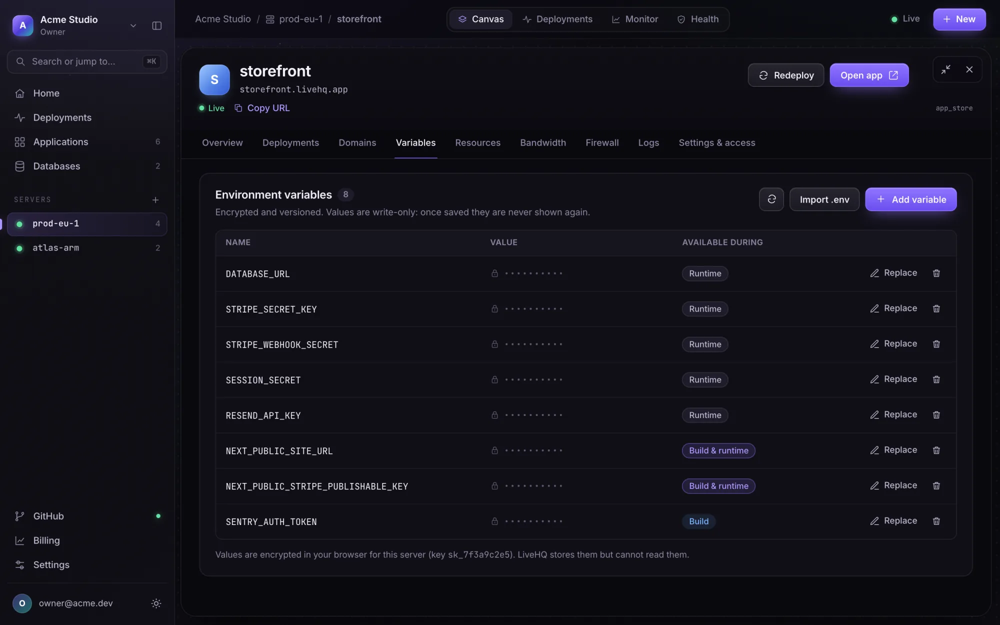

Variables are the settings and keys your app reads from its environment: a database connection URL, an API key, a feature switch. You manage them in the app's **Variables** tab. A saved variable reaches the app with its next deployment, not before.

Owners, admins and developers can change variables. Viewers see the names and scopes and cannot change anything. Nobody sees a saved value.

<Frame caption="The Variables tab of an app.">
  
</Frame>

## Add a variable

<Steps>
  <Step title="Open the form">
    Open the app, then **Variables**. Press **Add variable**.
  </Step>
  <Step title="Type the name and the value">
    Fill in **Name**, for example `DATABASE_URL`, and **Value**. The eye button shows what you typed. Names are case-sensitive.
  </Step>
  <Step title="Choose when it is available">
    Under **Available during**, pick **Runtime**, **Build** or **Build & runtime**. The table below says what each one means.
  </Step>
  <Step title="Save">
    Press **Save variable**. Your browser encrypts the value before it leaves the page. See [How LiveHQ protects variables](/apps/sealed-variables).
  </Step>
  <Step title="Apply it to the running app">
    The tab now shows **Saved changes aren't live yet**: the running release still uses the previous variables. Press **Review and redeploy**, then **Apply and redeploy**. An app that has no running release yet shows no such notice: its saved variables are included in the first deployment.
  </Step>
</Steps>

## Choose a scope

| Available during | Where the value exists | Use it for |
| --- | --- | --- |
| **Runtime** | In the running app's environment | Database URLs, API keys, anything the app reads while it runs |
| **Build** | Only while the app is being built | Tokens the build needs and the running app does not |
| **Build & runtime** | While building and in the running app | Values a framework reads at both times, such as a public site address |

<Warning>
A value available during the build can end up in files your visitors download. Frameworks copy variables with a public prefix, such as `NEXT_PUBLIC_` or `VITE_`, into the browser bundle. Never give a private key one of those names.
</Warning>

If you build with your own Dockerfile, build variables arrive as BuildKit secret mounts, not as `ARG` values. The secret's id is the variable's name:

```dockerfile
RUN --mount=type=secret,id=SENTRY_AUTH_TOKEN \
    SENTRY_AUTH_TOKEN="$(cat /run/secrets/SENTRY_AUTH_TOKEN)" npm run build
```

## Change, import or remove

- **Replace a value.** Press **Replace** on the variable's row, type the new value, and press **Save variable**. You can change the scope in the same form. The name cannot be changed: add a new variable and remove the old one.
- **Import many at once.** Press **Import .env** and paste the contents of a `.env` file. Lines like `NAME=value` are read; comments, blank lines and a leading `export` are accepted, and matching quotes around a value are removed. If a name appears twice, the later line wins. In a value without quotes, a space followed by `#` starts a comment, so put quotes around a value that contains one. One scope applies to everything in the import. The dialog lists the names it found, marks the ones that replace a saved value, and says which lines it skipped.
- **Remove.** Press the bin on the row, then **Remove**. The running release keeps its current value until the next deployment.
- **Connect a database.** This button gives the app its own user on one of your databases, saves that user's connection URL as a variable for you (`DATABASE_URL` or `REDIS_URL` unless you choose another name) and deploys the app. Removing that variable here does not end the connection: use **Disconnect** for that. See [Connect an app to a database](/databases/connect-an-app).

Every change needs the **Review and redeploy** step to reach the running app.

## Values are write-only

Once a value is saved, the console never shows it again, to you or to anyone else. The table shows the name, a row of dots and the scope. If you lose a value, you replace it; you cannot read it back. Keep your own copy of keys you cannot regenerate.

## What "Apply and redeploy" does

LiveHQ deploys the same source revision that is running now, with the saved variables. The running release keeps serving until the new one passes its health checks. Follow the deployment with **Follow it** in the **Redeploy queued** notice.

- A change to a **Runtime** variable normally reuses the last build, so it goes live faster than a full deployment.
- A change to a **Build** or **Build & runtime** variable builds the app again.
- Under **Release options** you can change the startup allowance (15 to 1,800 seconds) and allow an automatic rollback. See [Redeploy an app](/apps/redeploy).

A [rollback](/apps/rollback) brings a release back with the variables it had when it was deployed.

## Variables on the Deploy form

The Deploy form has a step named **Environment variables**. For a new app, press **Add variable** there to enter what the first deployment needs. For an existing app, the step lists the saved names with a **Replace** link: saved values are kept unless you replace them there.

Changes made on the Deploy form are saved when you deploy and apply to the new release. Values you typed and did not deploy are lost if you leave or refresh the page.

## PORT

You cannot add a variable named `PORT`. LiveHQ sets `PORT` itself and your app must listen on `0.0.0.0` at that port. The value comes from the **App port** field on the Deploy form. When that field is blank, LiveHQ uses the port your Dockerfile exposes, or 8080 for Railpack builds.

## Limits

| What | Limit |
| --- | --- |
| Variables per app | 64 |
| Name | 1 to 128 characters: letters, digits and underscores, starting with a letter or an underscore |
| One value | 16 KiB |
| All values of one app together | 64 KiB |
| Reserved name beginnings | `LIVEHQ_`, `LD_`, `DYLD_` |
| Reserved names | `PORT`, `PATH`, `HOME`, `HOSTNAME`, `USER`, `LOGNAME`, `SHELL`, `TERM`, `TMPDIR`, `ENV`, `BASH_ENV`, `IFS`, `HTTP_PROXY`, `HTTPS_PROXY`, `ALL_PROXY`, `NO_PROXY`, `NODE_USE_ENV_PROXY` |

An empty value is allowed and is saved as empty. Reserved names and beginnings are refused in any letter case: `path` is refused like `PATH`.

## If something goes wrong

| What you see | What it means | What to do |
| --- | --- | --- |
| **Saved changes aren't live yet** | The variables are saved, and the running release still has the previous ones. | Press **Review and redeploy**, then **Apply and redeploy**. |
| "Use letters, digits and underscores, starting with a letter or underscore." | The name has a dash, a dot, a space or starts with a digit. | Rename it, for example `API_KEY` in place of `api-key`. |
| "Names starting with LIVEHQ_, LD_ or DYLD_ are reserved." | LiveHQ and the system keep those names. | Choose another name. |
| An error that says the name "is reserved by the LiveHQ runtime" | The name is on the reserved list above, such as `PORT` or `PATH`. | Choose another name. For the port, set **App port** on the Deploy form. |
| "Settings changed. Refresh before saving your variables." | Someone else, or another tab, saved variables after you opened the page. | Reload the page and enter the value again. |
| "Start the app first. A stopped app keeps its saved configuration." | **Apply and redeploy** is refused while the app is stopped. | Open **Settings & access**, press **Start app**, then apply. |
| "These variables were saved before end-to-end encryption and will not be deployed. Replace each one, or remove it." | The values were saved in an older format that LiveHQ no longer delivers. | Press **Replace** on each one and enter the value again. |
| "Update this server's agent before saving variables." | The agent on the server is too old to open encrypted values. | See [Update the agent](/servers/update-agent). |

## Related

- [How LiveHQ protects variables](/apps/sealed-variables)
- [Redeploy an app](/apps/redeploy)
- [Deploy an app](/apps/deploy)
- [Connect an app to a database](/databases/connect-an-app)
