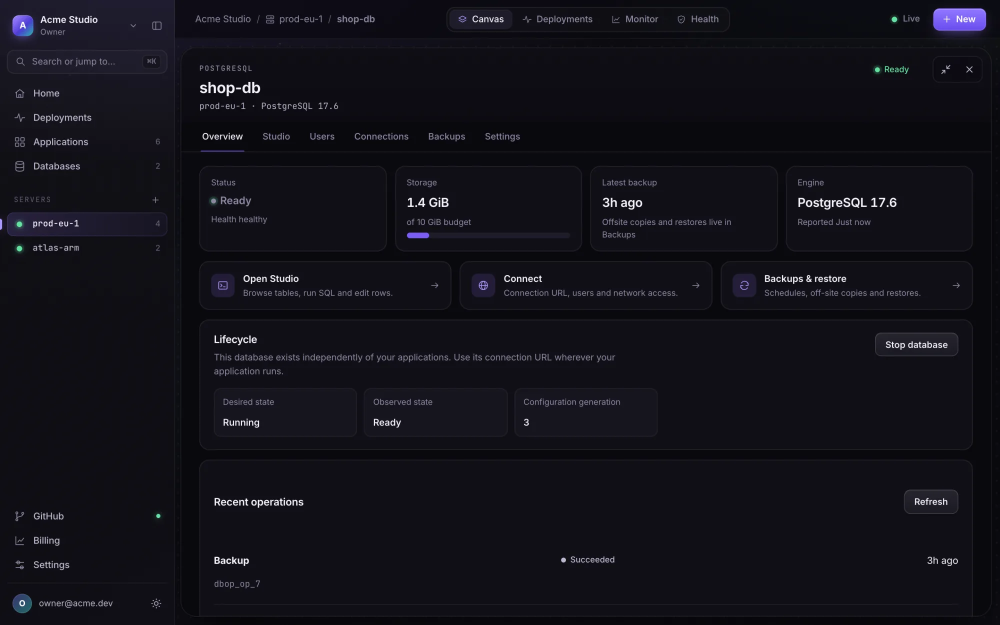

A LiveHQ database is PostgreSQL 17 or Redis 8 running on a server you rent, beside your apps. You create it and manage it in the console. Its data stays on your server's disk.

## What a database is here

- **It runs on your server.** It uses that server's memory, CPU and disk. Your plan sets how many databases you may have, not how large they are: 3 on Free, 30 on Pro, 100 on Teams, PostgreSQL and Redis counted together. See [Plans](/account/plans).
- **It exists on its own.** You create a database without an app. Deploying, rolling back or deleting an app never touches a database. You delete a database yourself, on its own page.
- **It is closed to the internet by default.** Apps on LiveHQ reach it over a private link. A public address exists only after you turn external access on. See [Get a connection URL](/databases/connection-urls).

## Find your databases

Open **Databases** in the sidebar. Each card shows the database's name, engine and version, its server, its status, how much storage (PostgreSQL) or memory (Redis) it uses, and **Backed up** with a time or **No backup yet**. **Create database** is at the top of the page.

## The tabs of a database page

<Frame caption="The Overview tab of a PostgreSQL database.">
  
</Frame>

| Tab | What you do there | Read |
| --- | --- | --- |
| **Overview** | See status, storage or memory, size, the latest backup and recent operations. Stop or start the database. | [Stop, start and delete](/databases/stop-and-delete) |
| **Studio** | Browse and edit data in the browser. Viewers do not see this tab. | [PostgreSQL Studio](/databases/postgresql-studio), [Redis Studio](/databases/redis-studio) |
| **Users** | Create users, reveal or reset passwords, revoke access. | [Users and passwords](/databases/users) |
| **Connections** | Connect an app, show the private and public URLs, limit who can connect. | [Connect an app](/databases/connect-an-app), [Get a connection URL](/databases/connection-urls) |
| **Backups** | Set a schedule, back up now, download, restore. | [Back up a database](/databases/backups), [Restore a database](/databases/restore) |
| **Settings** | Change the size, the name, the storage budget or the Redis memory rule. Delete the database. | [CPU, memory and connection limits](/databases/sizes-and-limits) |

## Status words

The status is what your server last reported. If the server is offline, the page keeps the last status it received.

| Status | What it means |
| --- | --- |
| **Provisioning** | The server is setting the database up. |
| **Ready** | It is running and answered its last health check. Connection URLs, Studio, users and backups need this status. |
| **Degraded** | It is running or restarting but did not answer its last health check. |
| **Stopped** | It is not running, because you stopped it or because the workspace's plan suspended it. The data is kept. |
| **Failed** | Setup did not finish, or the database kept crashing and the agent stopped restarting it. |
| **Deletion unfinished** | You asked to delete it and the server has not finished. See [Stop, start and delete](/databases/stop-and-delete). |

Under the status, **Health** reads `healthy`, `degraded`, `failed` or `unknown`. **Recent operations** at the bottom of Overview lists each action (create, backup, restore, update) with its result, and a failed one keeps the server's reason with **Copy diagnostics**.

## What LiveHQ does, and what stays yours

| LiveHQ does | You do |
| --- | --- |
| Starts the database in its own locked-down container and restarts it if it stops unexpectedly. | Choose a server with enough memory and disk. LiveHQ does not add either. |
| Generates every password. Nobody types one. | Keep connection URLs secret: each one contains a password. |
| Keeps the database off the internet until you ask for a public URL. | Decide who may connect from outside, and open the port at your hosting company if it has its own firewall. |
| Runs backups on Pro and Teams, on the schedule you set or when you press **Back up now**. | Turn a schedule on. A new database has no backups until you do. |
| Shows storage, memory and refused connections. | Watch them. LiveHQ sends no email when a database stops or fails. |

<Warning>
Backups are scheduled copies. There is no point-in-time recovery: a restore brings back the moment of a backup, and what changed after it is lost. On Free there are no backups at all.
</Warning>

## Related

- [Create a PostgreSQL database](/databases/create-postgresql)
- [Create a Redis database](/databases/create-redis)
- [Connect an app](/databases/connect-an-app)
- [Database connection problems](/help/database-connection)
