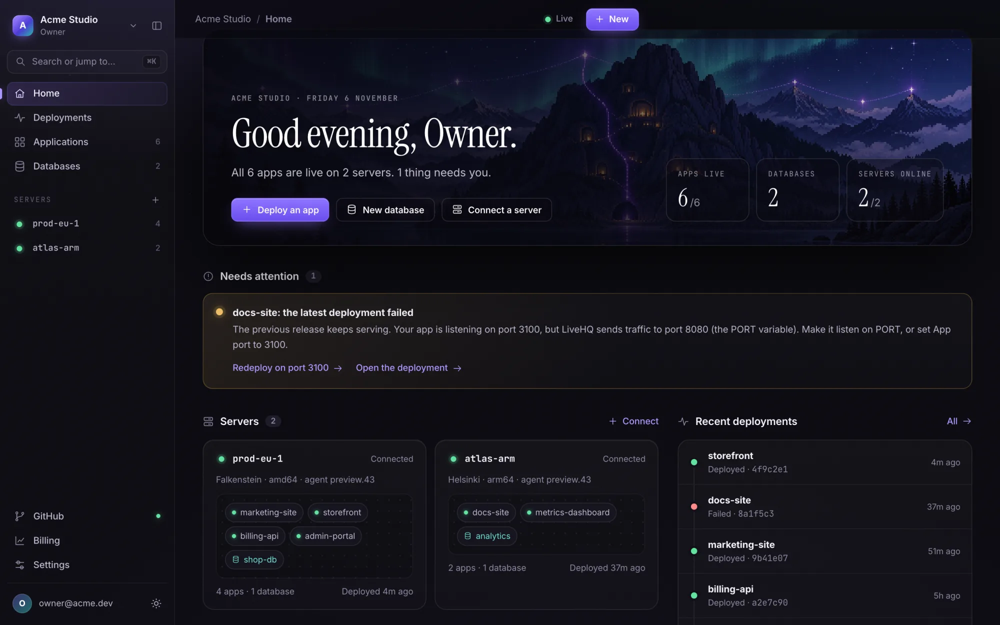

The build passed. LiveHQ then started the new release and waited for it to answer its health check. It did not, so the deployment failed and the previous release kept serving. While it waits, LiveHQ looks at the release (whether it runs, which ports it listens on, what it answers) and names the cause.

## The rule a new release must pass

1. It listens on `0.0.0.0`, which means every network interface. An app that listens on `127.0.0.1` or `localhost` cannot be reached.
2. It listens on the port in its `PORT` variable. That is **App port** if you set one, otherwise the single port your Dockerfile declares with `EXPOSE`, otherwise `8080` for an automatic build. A Dockerfile with no `EXPOSE` line, or with several, needs **App port**.
3. It answers `GET` on **Health check path** (`/` unless you changed it) with a status from 200 to 399, within 3 seconds, twice in a row. LiveHQ asks once a second.
4. It does so within the **Startup allowance**: 120 seconds unless you changed it.

Typical start commands that follow the rule:

```bash
# Node
node server.js            # with app.listen(process.env.PORT, "0.0.0.0")
# Python
uvicorn main:app --host 0.0.0.0 --port $PORT
gunicorn app:app --bind 0.0.0.0:$PORT
```

## Find the cause

The reason is shown in three places: on **Home** under **Needs attention**, on the app's **Overview**, and on the failed deployment in the app's **Deployments** tab.

<Frame caption="Home, with a failed deployment and its one-click fix.">
  
</Frame>

For more detail, open the failed deployment and read the **Application startup & health** card. LiveHQ writes there what it saw, such as "The app is listening on port 3100, not on 8080.", followed by the app's own output. A crash and its error message are in that output.

## Causes and fixes

Where a fix is one click, the console shows a link beside the reason. The link opens the Redeploy form with the right field ready. Nothing is deployed until you press **Deploy new release**.

| The reason begins | What it means | What to do |
| --- | --- | --- |
| "Your app is listening on port 3100, but LiveHQ sends traffic to port 8080 (the PORT variable)." | The app ignores `PORT` and uses its own port. | Press **Redeploy on port 3100**: **App port** is filled in for you. Or make the app listen on `PORT` and leave **App port** empty. |
| "Your app is listening on ports …" | Several ports are open, so LiveHQ does not pick one. | Press **Redeploy** and set **App port** to the port that serves HTTP. |
| "Your app is listening on 127.0.0.1:3000, which accepts connections only from inside its container." | The app listens on localhost only. | Change the app or its start command to listen on `0.0.0.0`, then deploy again. |
| "Your app didn't open a port within 120 seconds." | The app started too slowly, or it is not a web server. | Press **Redeploy with more startup time** and raise **Startup allowance (seconds)**, up to 1,800. An app that never serves HTTP belongs in a [background service](/apps/background-services). |
| "Your app answered GET / with HTTP 404." (any status from 400 to 499) | The health check path does not exist or needs a sign-in. | Press **Change the health check path** and set a page that answers 200. |
| "Your app answered GET / with HTTP 500." (500 and above) | The app runs and reports an error of its own. | Read the startup card. A missing variable or an unreachable database is the usual cause. |
| "Your app exited with code 1 before answering on port 8080." | The app crashed while starting. | Read the startup card for the error, fix it and deploy again. |
| "Your app ran out of memory while starting: it used its whole 512 MiB limit" | The app needs more memory than its limit. | Press **Redeploy with more memory** and pick a larger **Memory limit**. |
| "The server ran out of memory while this release was starting" | The server was full, not the app's own limit. Everything that already ran was kept. | See [Out of memory](/help/out-of-memory). |
| "Your app is listening on port 8080, but LiveHQ got no answer to GET /." or "… within 3 seconds." | The page is too slow, or the app hangs. | Point **Health check path** at a light page that answers at once. |
| "Your app answered GET / on port 8080 only some of the time." | The app answers, but not twice in a row within the allowance. | Read the startup card: the app is probably restarting itself. |
| "Your app never passed its health check. It must listen on 0.0.0.0 at the port in its PORT variable" | The server's agent is an old one that cannot name the cause. | Check rules 1 and 2 above. If the console says **Update this server's agent**, see [Update the agent](/servers/update-agent). |

A redeploy that changes only the port, the health check path, the startup allowance or the memory limit usually reuses the build, so it is quick. See [Redeploy an app](/apps/redeploy).

## How long a failure takes to show

- **A wrong port, localhost only or a 4xx answer** cannot be cured by trying again. LiveHQ fails the deployment once the cause has held for a quarter of the startup allowance, and for at least 30 seconds.
- **A full server** fails the deployment at once. LiveHQ does not start the release a second time.
- **A crash, no open port, a 5xx answer or no answer** may be passing. LiveHQ tries up to three times. A crash ends each try at once; the others can take three times the startup allowance to appear.

## Who sees the fix links

**Owners**, **Admins** and **Developers**, for an app that was deployed from GitHub. A background service has no port and no health check path, so only **Redeploy with more memory** applies to it.

## After the app starts

LiveHQ keeps asking the same path while the app runs, and restarts an app that stops answering: see [App restarts](/apps/restarts). If the app runs but its address does not open, see [An app is unavailable](/help/app-unavailable).

## Still stuck

On the failed deployment, press **Copy logs** and send the text to [support@livehq.dev](mailto:support@livehq.dev) with the app's name. Read it first and remove anything secret.

## Related

- [How LiveHQ builds an app](/apps/builds)
- [Follow a deployment](/apps/deployments)
- [A build failed](/help/build-failed)
- [App logs](/apps/logs)
