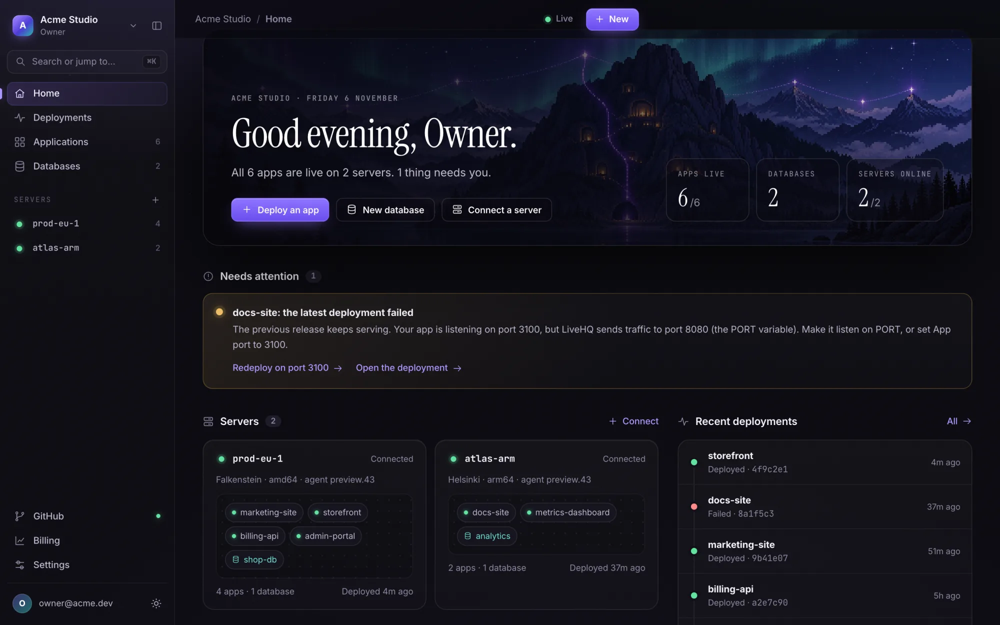

LiveHQ runs your apps and databases on a server that you rent in your own name. You paste one line into the server once. After that you do everything in the LiveHQ console, in your browser: deploy from GitHub, add a database, use your own domain, read logs.

Your server opens no web ports. Visitors reach your apps through LiveHQ's edge, which hands each request to your server over an encrypted connection that the server itself opened.

<Frame caption="Home in the console: your apps, your servers, and anything that needs you.">
  
</Frame>

## Pick your starting point

<Columns cols={2}>
  <Card title="I have never rented a server" icon="seedling" href="/start/rent-a-server">
    Four short steps, from nothing to an app online, with each screen explained.
  </Card>
  <Card title="I already have a server" icon="bolt" href="/quickstart">
    Connect it, connect GitHub, deploy. One page.
  </Card>
  <Card title="I come from Vercel, Render or Coolify" icon="right-left" href="/start/coming-from-other-platforms">
    The same ideas under LiveHQ's names, and what is different.
  </Card>
  <Card title="I am an AI agent" icon="robot" href="/agents/overview">
    A compact reference: the model, the order of steps, every status word and every limit.
  </Card>
</Columns>

## What you can do with LiveHQ

| You want to | Read |
| --- | --- |
| Put an app online from a GitHub repository | [Deploy an app](/apps/deploy) |
| Run a worker, a bot or a queue consumer | [Background services](/apps/background-services) |
| Add PostgreSQL or Redis | [Databases](/databases/overview) |
| Use your own domain | [Custom domains](/apps/custom-domains) |
| Decide who can open an app | [App access](/apps/access) |
| Keep the server closed and patched | [Server security](/servers/security) |
| Block attacks and limit abuse | [App firewall](/apps/firewall/overview) |
| Run an app on several servers | [Several servers](/apps/several-servers) |
| Understand a bill or a limit | [Plans](/account/plans) |

## What LiveHQ does not do

Better to know now than after you have built on it:

- It does not rent you the server. You rent it from a hosting company and pay them.
- It cannot serve a bare domain such as `example.com`, only names like `www.example.com`.
- Database backups are scheduled, on Pro and Teams. There is no point-in-time recovery, and no backups on Free.
- One deployment runs at a time on each server, and builds run on your own server.
- There is no public API and no command-line tool. You work in the console.

The full list is on [Known limits](/help/known-limits).

## When something goes wrong

Start with [Troubleshooting](/help/troubleshooting): it is sorted by what you see on screen. If you are still stuck, write to [support@livehq.dev](mailto:support@livehq.dev) and say which page you are on and what it shows. Leave out passwords and codes.
