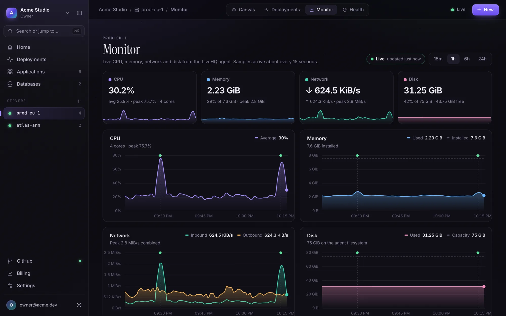

**Monitor** shows what a server is doing right now and over the last 24 hours: CPU, memory, network and disk, plus what each app uses. Open it when a server feels slow, before you add another app, or after a deployment.

## Open Monitor

Open the server, then press **Monitor** in the top bar. The server's **Health** page has a **Monitor** button too.

<Frame caption="Monitor for one server over the last hour. The diamonds mark deployments.">
  
</Frame>

## What is on the page

| Part | What it tells you |
| --- | --- |
| The badge beside the ranges | **Live** when the last sample is less than 45 seconds old. **Delayed** with its age when samples stopped arriving. "Waiting for samples" on a server that has not reported yet |
| The four tiles | The current value, with a second line for the range you picked: the average and the peak for CPU, the share of the total and the peak for Memory, the outbound speed and the peak for Network, the share of the total and the free space for Disk |
| **CPU** | The share of all the server's cores in use. The header says how many cores the server has |
| **Memory** | **Used** against **Installed**. Used is the installed memory minus what Linux reports as available, so memory that Linux only uses as file cache does not count |
| **Network** | **Inbound** and **Outbound** speed on the server's own network interfaces |
| **Disk** | **Used** against **Capacity** on the disk that holds the agent |
| **Applications** | A bar named **Memory in use** split by app, then a table of each app's CPU, memory against its limit, and network since it started. Press a column header to sort. Press a row to open the app |

The agent sends a sample about every 15 seconds.

## Pick a time range

The buttons **15m**, **1h**, **6h** and **24h** set how far back the charts go. Longer ranges average more samples into each point:

| Range | Each point covers |
| --- | --- |
| **15m** | 15 seconds |
| **1h** | 30 seconds |
| **6h** | 2 minutes |
| **24h** | 8 minutes |

An average can hide a short spike. On **6h** and **24h** the CPU chart therefore adds a dashed **Peak** line where the peak differs from the average.

## Read a chart

- **Move the pointer over a chart.** A line follows it on all four charts at once, and each chart shows its value at that moment. This is how you tell whether a CPU spike came with more network traffic or more memory.
- **Diamonds mark deployments on this server.** Each app's latest deployment is marked: when it went live, when it failed, or when it started if it is still running. Compare the charts before and after a diamond to see what a release changed.
- **A gap in a line** means no samples arrived then: the server was offline, restarting, or its agent was being updated.
- **Server CPU and app CPU use different scales.** Server CPU is the share of all cores, so it tops out at 100%. In the **Applications** table, one core counts as 100%, so an app on a 4-core server can show up to 400%.

## What the numbers mean for you

| What you see | What to think about |
| --- | --- |
| Memory **Used** close to **Installed** for long stretches | The server is full. The next build or deployment may fail with an out-of-memory reason. See [How memory is shared](/servers/memory) |
| An app's memory bar changes colour | The app uses more than 85% of its own memory limit. It is stopped and restarted if it reaches the limit. See [Resources and limits](/apps/resources) |
| CPU at 100% during a deployment only | Normal: the build runs on this server. Builds share spare CPU at a lower priority than your apps |
| Disk **Used** climbing after every deployment | Old releases are being kept. See [Disk space](/servers/disk-cleanup) |

## If something goes wrong

| What you see | What it means | What to do |
| --- | --- | --- |
| "This server has not sent a fresh heartbeat. Charts resume when it reconnects." | The agent is not checking in | See [A server is offline](/help/server-offline) |
| "Waiting for the first CPU sample…" | A new server has not reported yet | Wait a minute |
| The Network tile says it needs a newer agent | The server's agent is older than network charts | See [Update the agent](/servers/update-agent) |
| **Delayed** | Samples stopped arriving a moment ago | If it lasts, check the server's status on **Health** |

## Limits

- History keeps 24 hours. Older samples are gone.
- Monitor shows numbers. It sends no email when CPU, memory or disk passes a level.
- The Disk chart covers one disk, the one that holds the agent. The **Capacity** tab of **Health** shows every disk LiveHQ uses on the server.

## Related

- [How memory is shared on a server](/servers/memory)
- [Disk space](/servers/disk-cleanup)
- [Find your way around a server](/servers/server-pages)
