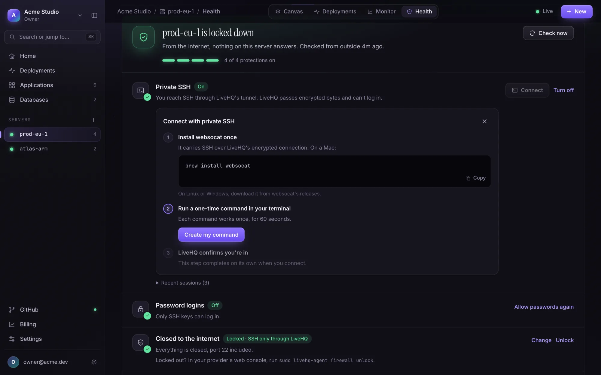

Private SSH carries your SSH session through the encrypted tunnel that your server already keeps open to LiveHQ. You no longer need port 22 open to the internet, so you can [close it](/servers/lock-down).

It is still your own SSH: the login happens between your computer and your server. Your SSH key never leaves your computer. LiveHQ passes encrypted bytes and cannot log in.

## Before you start

- The **Owner** or **Admin** role, and a server that reads **Connected**.
- A login that already works on the server: an SSH key, or the password you used until now. Private SSH changes the route, not the login.
- A terminal on your own computer.

## Steps

<Steps>
  <Step title="Turn private SSH on">
    Open the server, then **Health**, then **Security**. On the **Private SSH** row, press **Turn on**. The row reads "Private SSH is on." and the **Connect with private SSH** panel opens. Later, the **Connect** button opens the same panel.
  </Step>
  <Step title="Install websocat once">
    `websocat` is a small program that carries SSH over LiveHQ's encrypted connection. On a Mac:

    ```bash
    brew install websocat
    ```

    On Linux or Windows, download it from [websocat's releases](https://github.com/vi/websocat/releases) and put it where your terminal finds it.
  </Step>
  <Step title="Create your command and run it">
    Press **Create my command**, copy the command and paste it into the terminal on your computer. The bar under it counts down: "Works once, for 60 more seconds."

    The command is an ordinary `ssh` command that goes through `websocat` and signs in as `root`. If you sign in to this server under another name, replace `root` before the `@` at the end of the command with that name.

    The first time, SSH asks whether to trust the server's key. Type `yes`.
  </Step>
  <Step title="Let LiveHQ confirm you are in">
    When your session opens, the panel's last step turns to **You're connected**, with the time and the address you came from. Press **Done**. The row now reads **On**.
  </Step>
</Steps>

<Frame caption="The Connect with private SSH panel on the Security tab.">
  
</Frame>

<Warning>
The command contains a one-time ticket. Do not paste it into a chat or a document. It stops working after 60 seconds or after one use, whichever comes first.
</Warning>

## Turn password logins off

A password can be guessed. An SSH key cannot, in practice. Once you can sign in with a key, turn passwords off.

<Steps>
  <Step title="Make sure a key works">
    The server must already accept an SSH key for `root` or for a user who can run `sudo`. LiveHQ never adds keys for you. If you have signed in with a password until now, create a key on your computer and copy it to the server:

    <Tabs>
      <Tab title="Mac and Linux">
        ```bash
        ssh-keygen -t ed25519
        ssh-copy-id root@203.0.113.10
        ```
      </Tab>
      <Tab title="Windows (PowerShell)">
        ```powershell
        ssh-keygen -t ed25519
        type $env:USERPROFILE\.ssh\id_ed25519.pub | ssh root@203.0.113.10 "mkdir -p ~/.ssh && cat >> ~/.ssh/authorized_keys"
        ```
      </Tab>
    </Tabs>

    Use your server's address instead of `203.0.113.10`. Then open a new session and check that it no longer asks for the server's password.
  </Step>
  <Step title="Turn passwords off">
    On the **Password logins** row, press **Turn off passwords** and confirm. The server first checks that `root` or a `sudo` user has a key, and undoes the change if anything looks wrong. Sessions that are open stay connected.
  </Step>
</Steps>

The row then reads **Off**: "Only SSH keys can log in." LiveHQ does this with one settings file of its own and edits no other SSH file. **Allow passwords again** removes that file, and SSH follows the server's own configuration again.

If the row already read **Off** with no button, your hosting company set the server up for keys only. There is nothing to do.

## Turn private SSH off

Press **Turn off** on the row, then **Turn off private SSH**. Sessions open at that moment are cut. If the server is locked with port 22 closed, the console refuses and says to change the lock first, because private SSH is then your only way into SSH.

## If something goes wrong

| What you see | What it means | What to do |
| --- | --- | --- |
| "That command expired. Create a new one." | 60 seconds passed | Press **Create a new command** |
| `websocat: command not found` in your terminal | websocat is not installed, or not where the terminal looks | Install it, then create a new command |
| `Permission denied` in your terminal | The route works, but the server refused the login | Check the name before the `@`, and that your key or password is the right one |
| "This server's tunnel to LiveHQ isn't up right now. Try again in a minute." | The server's tunnel is reconnecting | Wait a minute and create a new command |
| "This server isn't connected to LiveHQ right now." | The agent has not checked in for 5 minutes | See [A server is offline](/help/server-offline) |
| The terminal ends at once with a connection error | The ticket was already used, or 4 sessions are open | Close a session you no longer need, then create a new command |

## Limits

- A command works once and for 60 seconds. At most 4 private SSH sessions can be open on a server at once.
- A session ends after 12 hours, or after 60 minutes with nothing sent.
- A large file copy over a slow connection can be cut off. `rsync` can resume it.
- Private SSH needs LiveHQ. If LiveHQ is unreachable, use your hosting company's web console, or the IP addresses you listed in the lock.
- Owners and admins get an email when private SSH is switched on or off, and when someone else opens a session. **Recent sessions** on the row lists who connected, from where and when.

## Related

- [The Security tab](/servers/security)
- [Close the server to the internet](/servers/lock-down)
- [The security model](/start/security-model)
