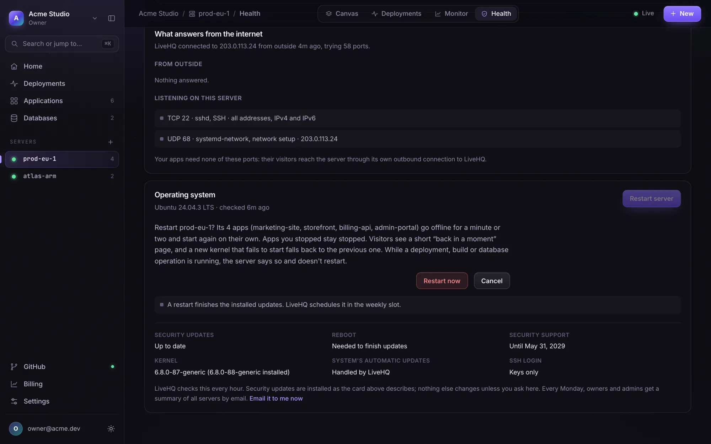

You can restart a server from the console, without opening a terminal. You need this when installed security updates are waiting for a restart and you do not want to wait for the planned one, or when the server misbehaves.

<Warning>
A restart takes every app and database on the server offline for a minute or two. They start again on their own.
</Warning>

## Before you start

- The **Owner** or **Admin** role, and a server that reads **Connected**.
- No deployment, build or database operation, such as a backup or a restore, running on the server.

## Steps

<Steps>
  <Step title="Open the Operating system card">
    Open the server, then **Health**, then **Security**. Scroll to the last card, **Operating system**.
  </Step>
  <Step title="Press Restart server">
    The card lists the apps that will go offline and asks you to confirm.
  </Step>
  <Step title="Press Restart now">
    If two-factor sign-in is on for your account, the console may first ask you to confirm it's you.
  </Step>
</Steps>

<Frame caption="The Operating system card with the restart confirmation open.">
  
</Frame>

When a restart is already planned, the **Security updates** card on the same tab has **Restart now…** as well. Both buttons do the same thing.

## What happens next

| The console says | What is happening |
| --- | --- |
| "Asking the server to restart…" | The request is on its way. A request the server never receives expires after 10 minutes, so it cannot restart the server later by surprise |
| "Restarting. Apps go offline briefly and start again on their own." | The server is shutting down and starting up |
| "Restarted. Running kernel" and its version | The server is back and the agent has reported |

During the restart:

- **Every app and database on the server is offline**, usually for a minute or two. How long depends on how fast your server boots.
- **Visitors see a short "back in a moment" page** instead of an error. A private app still asks its visitors to sign in first.
- **Apps start again on their own.** Apps you had stopped stay stopped.
- **The lock stays on** if you [locked the server](/servers/lock-down) and kept the lock.
- **A new system core (kernel) that fails to start falls back** to the previous one by itself, on servers that boot with GRUB.

LiveHQ does not send its "stopped responding" email for the first 10 minutes of a restart you asked for.

## What blocks a restart

The server refuses to restart, and says why, while a deployment or a build, a database operation such as a backup or a restore, an agent update or the installation of security updates is running. It does not wait for that work: when it has finished, press **Restart server** again.

## If something goes wrong

| What you see | What it means | What to do |
| --- | --- | --- |
| "The server hasn't come back after 10 minutes. Check it in your provider's console." You also get the email "prod-eu-1 didn't come back after its restart" | The server shut down and has not reported since | Sign in at your hosting company. Is the server running? Did it finish starting? Their console screen shows start-up errors. Restart it from there if it hangs. LiveHQ emails you when it reconnects |
| "The server is online but didn't restart. Try again, or restart it from your provider's console." | The server took the request but never went down | Try again. If it repeats, restart the server at your hosting company |
| "The server didn't restart. Try again." or a sentence from the server | The server refused, usually because work was running | Read the sentence, wait for that work, try again |
| No **Restart server** button | Your role is not Owner or Admin, or the server's agent is too old | See [Update the agent](/servers/update-agent) |
| An app reads **Unavailable** after the restart | It did not come back healthy | See [An app is unavailable](/help/app-unavailable) |

## Limits

- On a single server, a restart always takes its apps offline. An app keeps answering during a restart only if it also runs on another server: see [Several servers](/apps/several-servers), and restart them one at a time.
- The console can restart a server only while its agent is connected. A server that is frozen or offline has to be restarted at your hosting company.

## Related

- [Security updates and planned restarts](/servers/system-updates)
- [A server is offline](/help/server-offline)
- [The Security tab](/servers/security)
