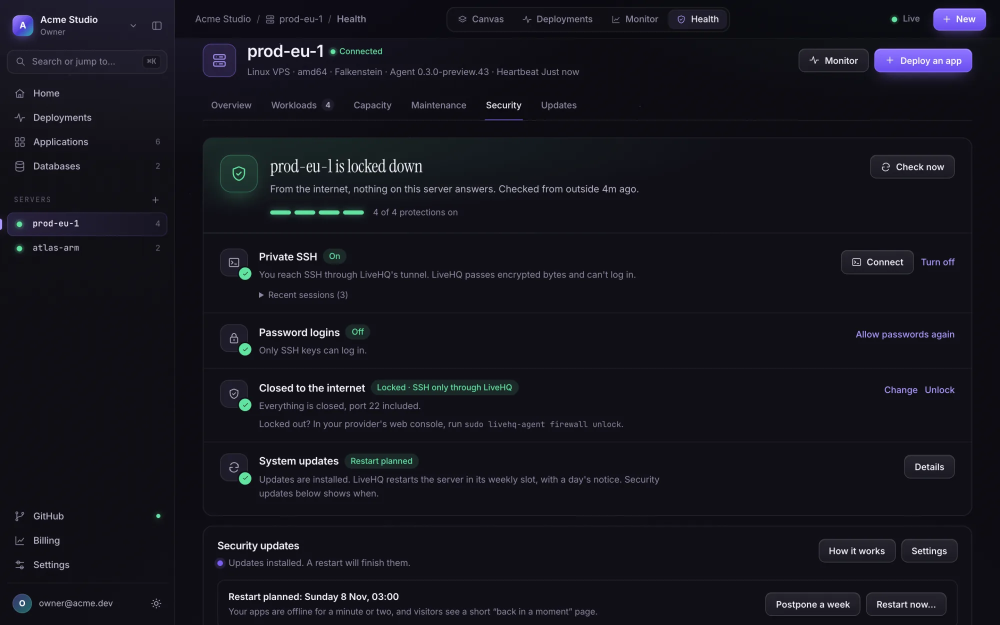

A new server answers the whole internet on every port that something listens on, and bots start trying SSH passwords within minutes. The **Security** tab shows how exposed a server is and walks you through closing it, one step at a time.

Open the server, then **Health**, then **Security**.

<Frame caption="The Security tab of a server with every protection on.">
  
</Frame>

## The top of the tab

- **The headline** says where you stand: "prod-eu-1 is locked down", or how many steps are left, such as "2 steps to lock down prod-eu-1".
- **The sentence under it** is the result of LiveHQ's check from outside, such as "From the internet, nothing on this server answers."
- **The meter** counts the protections that are on: "3 of 4 protections on".
- **Check now** asks the server for a fresh report and runs the check from outside again. The outside check runs at most once every 10 minutes per server, and by itself once a week.

## The checklist

The rows are in the order to turn them on. The first one left to do is marked **Next step** and carries the main button.

| Row | Status words | What it means | What to do |
| --- | --- | --- | --- |
| **Private SSH** | **Off**, **On · not used yet**, **On** | SSH that travels through LiveHQ's encrypted tunnel, so port 22 can close. Your SSH key never leaves your computer, and LiveHQ cannot log in | [Connect with private SSH](/servers/private-ssh) |
| **Password logins** | **Allowed**, **Off**, **Not reported** | Whether SSH accepts passwords. **Allowed** is the risk: bots try passwords on every server all day | [Turn password logins off](/servers/private-ssh#turn-password-logins-off) |
| **Closed to the internet** | **Open**, **Testing**, **Locked · SSH still open**, **Locked · SSH from your addresses**, **Locked · SSH only through LiveHQ** | Whether anything listening on the server can be reached from the internet. Your apps do not need it: their visitors arrive through LiveHQ | [Close the server to the internet](/servers/lock-down) |
| **Public databases** | "shop-db is reachable", or how many are | Shown only when a database's public connection answers from the internet. Anyone who has the password can try to connect | Press **Review shop-db**. Limit the connection to your IP addresses or turn it off. See [Connection URLs](/databases/connection-urls) |
| **System updates** | **Automatic**, **Installing automatically**, **Restart planned**, **Support ended** | Whether the system gets its security fixes | [Security updates and planned restarts](/servers/system-updates) |

With LiveHQ's security updates turned **Off**, the **System updates** row reads **Up to date**, a count of updates waiting, or **Restart needed** instead.

A row can also read **Needs an agent update** or **Needs the installer**. That protection is not counted until you [update the agent](/servers/update-agent).

Each change shows one progress line on its row, which ends only when the server itself reports the new state.

## What answers from the internet

Lower on the tab, this card gives the detail behind the headline.

- **From outside.** LiveHQ tries to connect to the server's public address on the ports the server says it listens on, plus about 60 common ones, 128 at most. The card names each port that answered, or says "Nothing answered."
- **Listening on this server.** What the server itself reports: one line per program and port, such as `TCP 22 · sshd, SSH · all addresses, IPv4 and IPv6`.

The check gives one of these verdicts:

| Verdict | Meaning |
| --- | --- |
| "From the internet, nothing on this server answers." | Closed. The goal |
| "Only SSH (port 22) answers from the internet." | Normal for a new server. Close it with private SSH and the lock |
| "SSH (port 22) and the public connection of database shop-db (port 5432) answer from the internet." | A database you opened on purpose. The lock leaves it to the database's own access settings |
| "Ports 22, 8080 answer from the internet." | Something else is reachable, such as a program or container you started yourself. The tab gets a dot |
| "Not checked from outside yet." | Press **Check now** |
| "LiveHQ can't confirm this server's public address yet, so it hasn't checked it from outside." | The server has no public IPv4 address that LiveHQ could confirm, for example behind a router that shares one address. Only the inside list is shown |

The check only tries to connect. It is not a scan for weaknesses in your apps.

## Operating system

The last card shows the system and when it was checked, with these facts: **Security updates**, **Reboot**, **Security support** (until when the system gets fixes), **Kernel**, **System's automatic updates** and **SSH login**. LiveHQ refreshes them every hour. **Restart server** is on this card: see [Restart a server](/servers/restart).

Every Monday, owners and admins get an email summary of all servers. **Email it to me now** sends the current one.

## Who can change things

Everyone in the workspace can read the tab. The buttons appear for the **Owner** and **Admin** roles. If two-factor sign-in is on for your account, the console asks you to confirm it's you before a change, when your last confirmation is more than 15 minutes old.

## If something goes wrong

| What you see | What it means | What to do |
| --- | --- | --- |
| "prod-eu-1 didn't pick this up in time. Check it's online, then try again." | The server did not receive the request | Check the server reads **Connected**, then try again |
| "The server applied it, but its report hasn't arrived yet. Refresh the page in a minute." | The change was made. The confirmation is late | Reload the page after a minute |
| "The server didn't make this change. Try again." or another sentence from the server | The server refused and nothing changed | Read the sentence: it says why |
| "The check from outside didn't run. Check now tries again." | The outside check was skipped | Press **Check now** |
| "No report yet." on the **Operating system** card | The server's agent is older than this card | [Update the agent](/servers/update-agent) |

## Related

- [The security model](/start/security-model)
- [Connect with private SSH](/servers/private-ssh)
- [Close the server to the internet](/servers/lock-down)
- [Security updates and planned restarts](/servers/system-updates)
