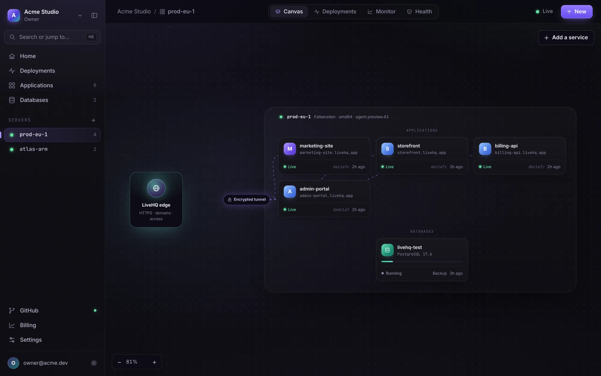

Every server in your workspace has four views. This page says what each one is for, so you know where to look.

## Open a server

Your servers are listed under **Servers** in the sidebar. The light beside each name is lit while the server is connected, turns violet while one of its apps is deploying, and is off when the server is offline. Hovering over a name says "connected" or "offline". Press a name to open the server.

The top bar then shows four views of that server: **Canvas**, **Deployments**, **Monitor** and **Health**.

## The four views

| View | What it shows | Use it to |
| --- | --- | --- |
| **Canvas** | A picture of the server: **LiveHQ edge**, the **Encrypted tunnel**, then each app, background service and database on the server | See what runs here at a glance. Press a card to open that app or database in a side panel. **Add to prod-eu-1** creates something new on this server |
| **Deployments** | The latest deployment of each app on this server, grouped by day, with the filters **All**, **In progress**, **Failed** and **Deployed** | Check what was deployed and what failed. Open an app for its full history |
| **Monitor** | Charts of CPU, memory, network and disk, and the use of each app | [Read the Monitor charts](/servers/monitor) |
| **Health** | Seven tabs about the server itself, listed below | Maintain, secure and update the server |

<Frame caption="A server's Canvas. Visitors reach the apps only through LiveHQ's edge and the encrypted tunnel.">
  
</Frame>

On the Canvas, the **−** and **+** buttons zoom, and the percentage between them fits the picture to the view again.

## The tabs of Health

The top of Health shows the server's name, its status (**Connected** or **Offline**), its system type, processor type, region and agent version, and when its last heartbeat arrived. A heartbeat is the agent's regular check-in with LiveHQ.

| Tab | What it shows |
| --- | --- |
| **Overview** | Notices that need you, such as an app that keeps failing. **Live usage** for the last 15 minutes. A **Status** card: **Agent**, **OriginLink** (the encrypted tunnel), **Last heartbeat**, **Clock**, **Workloads**, **Independent checks** and **Outage protection**. The apps on the server. Two commands to inspect the agent over SSH. **Remove server** at the bottom |
| **Workloads** | Each app and database as the server itself sees it: its state (such as healthy, stopped or crash loop) and how often it was restarted. An app or database that stops is restarted automatically. The **Independent checks** card stays empty today: LiveHQ runs no check of your apps from outside the server |
| **Capacity** | **Memory**: what is free now and how the memory limits add up. **Build resources**. **Storage**: what uses the disk. See [How memory is shared](/servers/memory) |
| **Maintenance** | **Resource collection**: which old releases LiveHQ keeps and removes. See [Disk space](/servers/disk-cleanup) |
| **Security** | The protection checklist, **Security updates**, **What answers from the internet** and **Operating system**, with **Restart server**. See [The Security tab](/servers/security) |
| **Updates** | The agent's version and **Update agent**, the update schedule and security advisories. See [Update the agent](/servers/update-agent) |
| **Settings** | **Export everything**: a copy of the server's apps, settings and data that works without LiveHQ. See [Export](/help/export) |

Some tabs carry a marker:

- **Workloads** shows how many apps and databases the server reports. The number turns red and counts only the ones that need attention when any do.
- **Maintenance** shows how many old releases are ready to collect.
- **Updates** shows a dot when an agent update is pending or the installed release was withdrawn.
- **Security** shows a dot when the system needs attention or an unexpected port answers from the internet.

## Who can do what

Everyone in the workspace can open every view. The buttons that change a server appear only for the **Owner** and **Admin** roles: connecting, removing, locking, updating, restarting and changing security updates. A **Developer** can deploy to the server and a **Viewer** can only read. See [Members and roles](/account/members-and-roles).

## If something goes wrong

| What you see | What it means | What to do |
| --- | --- | --- |
| "Server unavailable." | The server is not in the workspace you are looking at | Switch workspace at the top of the sidebar, or check that the server was not removed |
| "The server has not sent a fresh online heartbeat. It may be restarting, disconnected or stopped." | The agent has not checked in | See [A server is offline](/help/server-offline) |
| A tab is missing, or a card says **Update this server's agent** | The server's agent is older than that feature | See [Update the agent](/servers/update-agent) |

## Related

- [Read the Monitor charts](/servers/monitor)
- [The Security tab](/servers/security)
- [A tour of the console](/start/console-tour)
