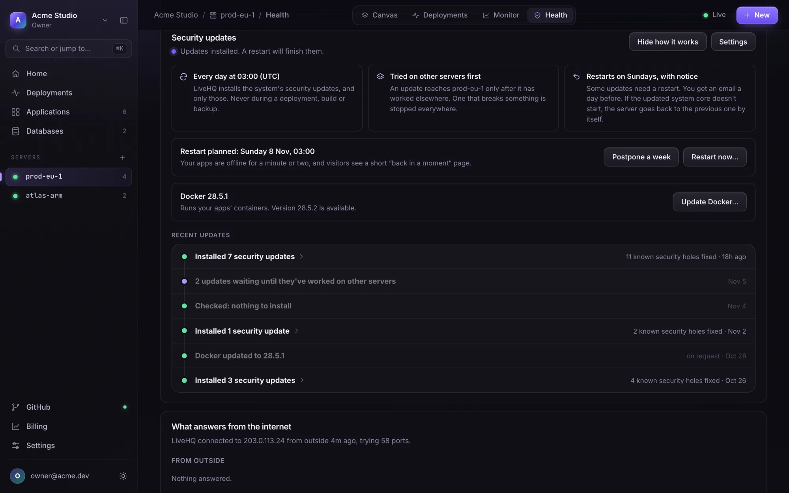

Most servers are broken into through holes that already have a fix. LiveHQ therefore installs your system's security updates for you and, when an update needs it, restarts the server at a planned time. This is on from the moment a server is connected. You can change every part of it.

Open the server, then **Health**, then **Security**, and scroll to the **Security updates** card.

<Frame caption="The Security updates card, with a restart planned and a Docker update available.">
  
</Frame>

## What LiveHQ does

| | What happens |
| --- | --- |
| **Every day** | During the server's maintenance window, 03:00 to 04:00 UTC unless you change it, LiveHQ installs the system's security updates and only those. Never a new version of the system, and never during a deployment, build or backup. Your apps keep running |
| **Tried on other servers first** | A new update reaches your server only after it has worked on other servers, so it can arrive a day or two after it is published. One that breaks something is stopped everywhere. **Install now** skips the wait, never a stop |
| **Restarts** | Some updates, mostly to the system core (the kernel), take effect only after a restart. LiveHQ plans it for your restart day, Sunday by default, at the window's start, at most once a week. It emails owners and admins as soon as the restart is planned, at least 24 hours ahead |
| **A safety net** | If the updated kernel does not start, the server goes back to the previous one by itself. This works on servers that boot with GRUB |

While LiveHQ is in charge, the system's own automatic installer is switched off so the two do not collide. Turning LiveHQ's updates **Off** gives it back.

## A planned restart

The card reads "Restart planned:" with the day and time. During the restart your apps and databases are offline for a minute or two and start again on their own. Visitors see a short "back in a moment" page.

| Button | What it does |
| --- | --- |
| **Postpone a week** | Moves the restart to the same slot next week |
| **Restart now…** | Asks for confirmation, then restarts at once. While a deployment, a build, a database operation, an agent update or the installation of updates is running, the server does not restart and says why. It does not wait, although the confirmation says so: press the button again afterwards |
| **Approve for Sunday 03:00** | Shown in **I approve restarts** mode. Without your approval the server is not restarted |

At the planned time, a restart is put off while a deployment, a build, a database operation or an agent update is running, and tried again about every 10 minutes until the window ends. A server that was off or busy for its whole window gets the next week's slot, with a new email unless you had approved the restart yourself.

## Settings

Press **Settings** on the card, choose, then **Save**.

| Mode | What LiveHQ does |
| --- | --- |
| **Automatic** (Recommended) | Installs security updates every day and restarts the server when one needs it, on your restart day, with an email at least a day before |
| **I approve restarts** | Installs security updates every day. Restarts wait for your OK |
| **Off** | Only shows what is waiting. The system's own automatic updates take over again |

| Field | Choices |
| --- | --- |
| **Restart day** | Monday to Sunday |
| **Docker updates** | **Ask me each time**, or **Automatic for bug-fix releases** |
| **Pause** | **Pause for 1 day**, **Pause for 3 days**, **Pause for 7 days** or **Pause for 14 days**. Nothing installs or restarts until then. **Resume now** ends it |

The time of day comes from the server's maintenance window. To change it, open the **Updates** tab and press **Edit schedule**: **Timezone**, **Start time** and **Window length**.

## Docker updates

Docker runs your apps' containers, so LiveHQ updates it separately. When a newer version is available, the card offers **Update Docker…** and says which kind it is:

- **A bug-fix release:** LiveHQ first makes Docker keep your apps running while it restarts, so they should not notice.
- **A bigger release:** your apps restart with Docker and are back within about a minute.

Either way the update waits until no deployment, build or backup is running. By default LiveHQ asks you each time.

LiveHQ updates Docker only when it was installed from Docker's own packages, as the LiveHQ installer does. A Docker that came with the system's packages gets its fixes with the security updates, and the card says so.

## The buttons and the history

- **Install now** installs the waiting security updates at once. With nothing waiting, the button reads **Check now**.
- **Recent updates** lists each run, such as "Installed 7 security updates" with "11 known security holes fixed". Press a line to see the packages.
- **Waiting** lists updates held back, with the reason, such as "waiting until it has worked on other servers".

## The emails

They go to the workspace's owners and admins.

| Subject | When |
| --- | --- |
| "prod-eu-1 restarts Sunday, November 8 at 03:00 (UTC)" | When a restart is planned, at least 24 hours before it |
| "prod-eu-1 needs a restart to finish its security updates" | In **I approve restarts** mode |
| "prod-eu-1 didn't come back after its restart" | 10 minutes after a restart that did not finish |
| "prod-eu-1 returned to its previous kernel" | The safety net was used. Nothing to repair |
| "An update keeps failing on prod-eu-1" | A package failed twice and is held on this server |
| "Security updates haven't installed on prod-eu-1 for a week" | Something blocks the updates, such as a full disk |

Every Monday, owners and admins also get a summary of all servers.

## If something goes wrong

| What you see | What it means | What to do |
| --- | --- | --- |
| "Not active yet. This server needs the latest LiveHQ agent." | The agent is older than managed updates | [Update the agent](/servers/update-agent). Your choices in **Settings** apply as soon as it runs |
| "Less than 1 GB is free on this server, so updates wait until there is room." | The disk is nearly full | See [A disk is full](/help/disk-full) |
| "Failed twice, so held on this server:" and package names | One package will not install. Everything else keeps updating | Open the run under **Recent updates** to read the error. Fix the cause and install it yourself, or write to [support](/help/support) |
| "Not available on this system" | LiveHQ does not manage updates on this system | Install updates with the system's own tools |
| The **System updates** row reads **Support ended** | The system's release no longer gets security fixes | Move your apps to a server with a supported release |

## Limits

- LiveHQ installs the system's security updates and Docker. It does not update what is inside your apps: an app gets newer packages when you redeploy it.
- A restart takes your apps offline for a minute or two.
- An update that waits for other servers is not installed on yours yet. Use **Install now** for a fix you need today.

## Related

- [Restart a server](/servers/restart)
- [The Security tab](/servers/security)
- [Emails LiveHQ sends](/help/emails)
