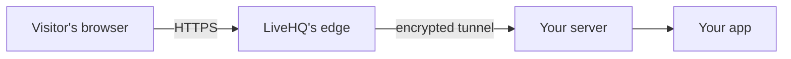
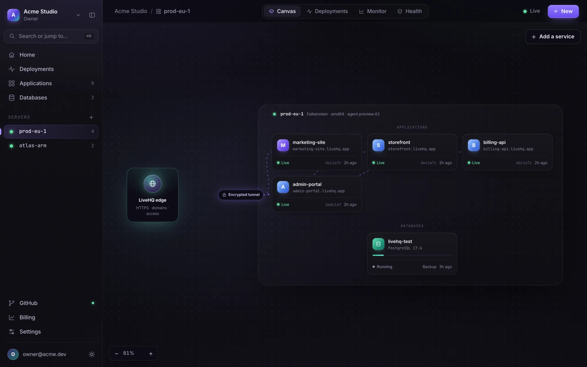

LiveHQ has four parts. Knowing them makes every other page easier to read.

| Part | Where it runs | What it does |
| --- | --- | --- |
| **The console** | Your browser, at `console.livehq.dev` | Where you do everything: connect servers, deploy, read logs, manage databases. |
| **Your server** | At the hosting company you chose | Builds and runs your apps and databases. Your code and your data live here. |
| **The agent** | On your server | A small program LiveHQ installs. It carries out what you ask in the console, using Docker. |
| **LiveHQ's edge** | On LiveHQ's side | Receives every visitor's request, checks who may open the app, and passes the request to your server. |

## How a visitor reaches your app

1. The visitor opens your app's address, such as `storefront.livehq.app`.
2. The request arrives at LiveHQ's edge. For a private app, the edge checks that the visitor may open it. The app firewall runs here too.
3. The edge passes the request through an **encrypted tunnel** to your server.
4. Your app answers, and the answer goes back the same way.

Your server opens that tunnel itself, outward, when it starts. Nothing has to connect inward, so the server needs no open web ports and its IP address does not appear in your app's DNS.

<Frame caption="A server's Canvas draws this path: the edge, the tunnel, and each app and database on the server.">
  
</Frame>

## How a deployment happens

1. You press **Deploy application**, or you push to GitHub with deploy on push switched on.
2. The agent on your server fetches the code from GitHub and **builds** it there into an image: a packaged copy of your app with everything it needs.
3. The agent starts the new **release** beside the one that is running and asks it for its health check.
4. When the new release answers, traffic moves to it and the deployment reads **Live**. LiveHQ watches it for a minute and keeps the previous release ready to roll back.

A failed build or a release that never answers changes nothing for visitors: the previous release keeps serving.

One deployment runs at a time on each server. Others wait their turn.

## The words LiveHQ uses

| Word | Meaning |
| --- | --- |
| **Workspace** | The place that holds your servers, apps, databases, people and plan. You can belong to several. |
| **Server** | A Linux server you rent, connected to a workspace by the install line. |
| **App** | Something built from a GitHub repository and run on a server. A **web app** has an address. A **background service** has none. |
| **Deployment** | One attempt to put a version of an app online: fetch, build, start, health check, go live. |
| **Release** | The running result of a deployment. An app has one live release and keeps the previous one for rollback. |
| **Address** | Where an app is reached: its LiveHQ address (`name.livehq.app`) and any custom domain. |
| **Variables** | Settings and secrets your app reads from its environment, such as `DATABASE_URL`. |
| **Database** | A PostgreSQL or Redis database on one of your servers. It exists independently of any app. |
| **Limit** | The most memory or CPU an app or database may use. A cap, not a reservation. |

More words are in the [glossary](/help/glossary).

## What lives where

| | On your server | At LiveHQ |
| --- | --- | --- |
| Your app's code and images | Yes | No. Only build output, kept 24 hours so you can read it. |
| Your databases' data | Yes | No, except what you open in Studio: queries and their results pass through LiveHQ and are kept 24 hours |
| Database backups | Yes, and offsite when you turn that on | Offsite copies are stored encrypted |
| Variables | Opened only on your server | Stored sealed: LiveHQ cannot read the values |
| Settings, deployment history, usage figures | | Yes |

See [How LiveHQ keeps your server safe](/start/security-model) for what LiveHQ can and cannot see.

## What depends on LiveHQ being up

Your apps run on your server, but visitors reach them through LiveHQ's edge. If LiveHQ's console and API are down, public apps keep serving for up to 72 hours and private apps pause. See [What happens during a LiveHQ outage](/help/outages).

## Related

- [A tour of the console](/start/console-tour)
- [Deploy an app](/apps/deploy)
- [Known limits](/help/known-limits)
