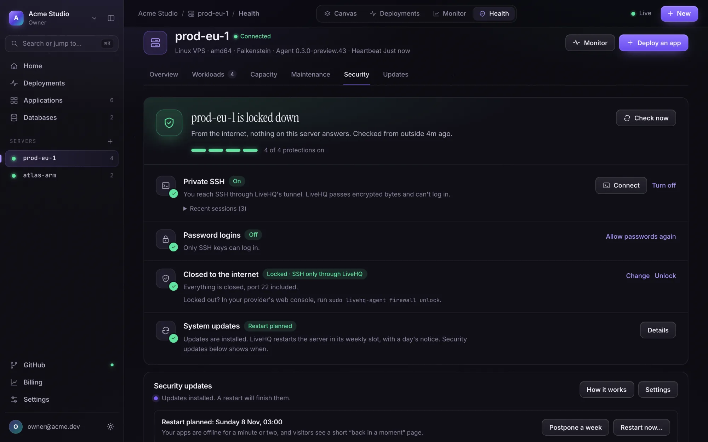

LiveHQ manages a server that belongs to you. This page explains what protects that server and your apps, then lists plainly what LiveHQ can see and do, so you can decide how far to trust it.

## The short version

- Your server opens no web ports, and its IP address is not in DNS.
- Visitors reach your apps only through LiveHQ's edge and an encrypted tunnel that your server opens outward.
- A private app's visitors are checked at the edge, before a request reaches your server.
- The values of your variables are encrypted in your browser. Only your server can open them.
- LiveHQ holds no SSH key to your server and cannot log in to it.
- LiveHQ's agent does run as root on your server and takes commands from LiveHQ, including deployments. Read [what LiveHQ can see and do](#what-livehq-can-see-and-do) before you rely on the points above.

## How visitors reach an app

Your apps listen on the server's loopback address, which only the server itself can reach. The agent opens a tunnel outward to LiveHQ's edge, and visitors' requests travel back through it. Nothing on the server waits for web traffic from the internet, so there is no web port to scan.

Your addresses, such as `storefront.livehq.app` or `www.example.com`, point at LiveHQ's edge, not at your server. The server's IP address stays out of DNS. One exception: a database you give a public endpoint gets a name that points at the server.

The edge signs every request it sends through the tunnel, and your server checks the signature.

For a private app, the edge checks who is asking before the request goes any further. New apps start **Private**. A [background service](/apps/background-services) has no address at all, so nothing on the internet can send it a request. Each app also has its own [firewall](/apps/firewall/overview) at the edge.

## The server itself

Installing LiveHQ does not close what was already open. Until you change it, SSH on port 22, and anything else you installed, still answers from the internet. The server's **Security** tab shows what answers and gives you the switches to close it.

<Frame caption="The Security tab of a server with every protection on.">
  
</Frame>

| Protection | What it does |
| --- | --- |
| Check from outside | Your server lists everything that listens beyond itself. LiveHQ then tries those ports and about 60 common ones from the internet, every week and when you press **Check now** |
| Private SSH | You reach SSH through the server's own tunnel with a one-time command that works once, within 60 seconds. It can only reach the server's own SSH service. Your key stays on your computer; LiveHQ relays encrypted bytes, never adds a key to your server and never issues SSH certificates |
| Password logins off | SSH accepts keys only |
| The lock | Closes every port on IPv4 and IPv6, SSH included if you choose. It starts as a five-minute trial and removes itself unless you keep it. A kept lock stays shut even if the server loses contact with LiveHQ; your hosting provider's web console is the way back in |

See [Server security](/servers/security), [Private SSH](/servers/private-ssh) and [Lock down a server](/servers/lock-down).

## Variables are sealed in your browser

When you save a variable, the console encrypts its value in your browser with a key that belongs to the app's server. LiveHQ stores the sealed value and hands it to the server at deployment. LiveHQ refuses a value that is not sealed, and nothing at LiveHQ can open what it stores. The server opens a value only if it was sealed for exactly that app, name and server.

What this costs you:

- LiveHQ cannot show a saved value again. Keep your own copy.
- If the server is lost or its disk is wiped, its key is gone and you enter the values again.

See [Sealed variables](/apps/sealed-variables).

## Builds and containers

Your code is built on your own server, never on build machines shared with other customers. Apps run in containers with every Linux capability dropped, no privilege escalation, a system-call filter, memory, CPU and process limits, and networks that cannot reach your host or your local network.

## Updates

- **System security updates.** Your server installs its distribution's security updates every day. They come only from the distribution's security channel, as your server finds them: LiveHQ cannot name a package to install, it can only hold one back. A restart that updates need happens at a planned weekly time with an email a day before, or waits for your approval. If a new kernel does not start, the server returns to the previous one. Docker updates come from Docker's own repository. You can pause all of this or turn it off. See [System updates](/servers/system-updates).
- **Agent updates.** Every agent release is signed with a key kept offline, away from LiveHQ's servers. Your server verifies the signature before it installs one.

## Your LiveHQ account

Whoever can sign in to your account can deploy to your servers, so protect it. LiveHQ offers an authenticator app, passkeys and recovery codes, and with two-factor sign-in on, risky actions ask for your second step again. A server is connected with a single-use code from the console, so your LiveHQ password is never typed on a server. See [Turn on two-factor sign-in](/account/two-factor).

## What LiveHQ cannot do

These hold because of how LiveHQ is built, not because of a policy.

- Read the values of your app variables: not from its database, not from its backups, not through its staff.
- Log in to your server or open a shell on it. LiveHQ sends typed, exact commands only. A command you run from an app's **Run** tab stays inside that app's container.
- Open a server export. It is encrypted to a key that exists only in your open browser tab. See [Take your data with you](/help/export).
- Install an agent update your server has not verified against the offline release key.
- Choose a package for your server to install.
- Reach your apps except through the tunnel your own server opened.

## What LiveHQ can see and do

Running the service requires these. Anyone who took control of LiveHQ could do the same.

- **Give your server commands, as root.** The agent is LiveHQ's program and runs as root on your server. It accepts a fixed set of commands with exact targets, such as deploy this release, restart this app, run this command inside this app's container, restart the server, apply or remove the lock, install the waiting security updates. It accepts no shell text for the host. A deployment, though, runs code: LiveHQ could order a deployment onto your server, where it would run as an app in a container.
- **Reach a running app's values through such a deployment, or a command in its container.** Sealing protects the values stored at LiveHQ. Code that runs as your app, or a command run in its container, can read that app's variables, whoever ordered it. LiveHQ masks those values in a command's output, on your server, before the output leaves it.
- **See requests to your apps as they cross the edge.** HTTPS ends at the edge so it can route requests and check access, as it does at any service that sits in front of a website.
- **See the names of your variables,** so the console can list them.
- **Read your build and deployment logs, the app logs you open in the console, and usage figures.** For 7 days it also keeps the commands you run in an app with their output, with variable values masked.
- **See what you do in Studio.** The queries you run in a database's Studio and the rows they return pass through LiveHQ on their way to your browser. They are kept for 24 hours, protected by a key LiveHQ holds.
- **Know who you let in.** Your account's email address, and the addresses you invite to a workspace or share an app with, are stored at LiveHQ so it can send the invitations and check visitors.
- **Open database passwords and backups.** Database passwords and backup keys are protected by a key LiveHQ holds. They are not sealed like app variables. Offsite backup copies are encrypted, and LiveHQ holds those keys so it can restore them for you.
- **Read the repositories you connect.** The GitHub access you grant can read the repositories you select.
- **Know your server's public address,** which it checks from outside every week and when you ask.
- **Keep, for 24 hours, details of requests your app's firewall refused or logged,** such as IP address, country and path.
- **Reach your server's SSH port through private SSH, and remove a lock.** It still cannot log in without one of your keys. Owners and admins are emailed when the lock changes or a session is opened by someone else.

## What is not done yet

- An independent security review. It is planned before general availability.
- Hardware-backed signing for the keys LiveHQ's platform holds.
- Your own approval of a server's sealing key. Today your browser remembers each server's key and blocks saving if it changes. That is an alarm, not a lock: someone in control of LiveHQ could substitute a key for values saved while they held control.

## What you are responsible for

| Yours | Why |
| --- | --- |
| Your app's code and its dependencies | LiveHQ updates the server's system packages and Docker, not what is inside your app's image. Deploy again to pick up fixes |
| What is in your databases, and who holds their connection URLs | A database with a public endpoint is reachable from the addresses you allow |
| Your hosting account | Whoever controls it controls the server, whatever LiveHQ does. Turn on two-factor sign-in there too. Its web console is your way back in if you are locked out |
| Your SSH keys, and anything you install on the server outside LiveHQ | The ports such software opens are yours to close. The check from outside lists them |
| Your LiveHQ account and the people you invite | Turn on two-factor sign-in; give each person the lowest role that works |
| Your own copies | Variable values cannot be shown again. The Free plan has no database backups |
| A supported system release | LiveHQ warns you 90 days before your Ubuntu or Debian release stops receiving security updates. Moving to a newer release is yours to do |

## Related

- [How LiveHQ works](/start/how-livehq-works)
- [What happens during an outage](/help/outages)
- [Emails LiveHQ sends](/help/emails)
- The same list, as published on the website: [livehq.dev/security](https://www.livehq.dev/security)
